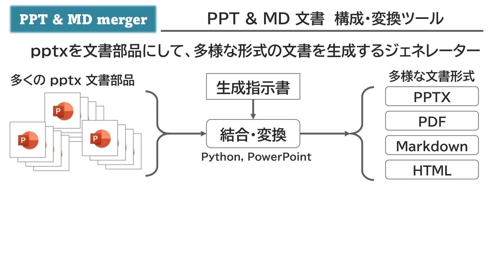
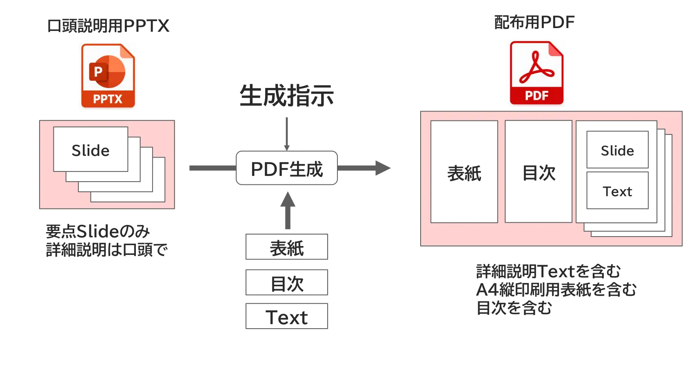
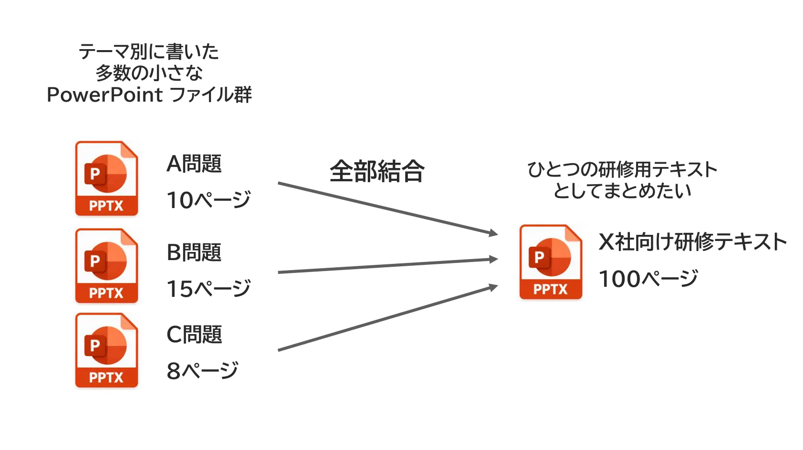

<!-- source: ../mds/readme_file_slide1.md -->
<!-- md_merge_rawtitle: PPT & MD merger とは？ -->
<!-- #id:section:readme_file:slide1 -->
## PPT \& MD merger とは？

PPT \& MD merger は、「pptxファイルを文書部品として扱い、多様な形式の文書を生成できるジェネレーター」 です。　（ツールそのものは Python スクリプトであり、Windows + PowerPoint 環境で動作します）




<!-- source: ../mds/readme_file_slide2.md -->
<!-- md_merge_rawtitle: 複数のPPTXをまとめて１つのPDFを生成する用途 -->
<!-- #id:section:readme_file:slide2 -->
## 複数のPPTXをまとめて１つのPDFを生成する用途

PPT \& MD merger の主な用途の１つが、複数の PowerPoint ファイル *.PPTX （基本的にはプロジェクター投影＋口頭説明という形で使用するもの）をソースにして、配布用PDFファイル（印刷して、またはデータで配付して「読むだけで理解してもらうことを期待する」もの）を作成することです。　



さらに、このときに生じる

> **BLOCKINDENT**
>
> - 複数のPPTXをまとめて１つの配布用PDFにしたい
> - 口頭で説明していた内容を詳細説明Textとして追加したい
> - プレーンテキストでは物足りない。文字サイズ、フォント、配色などを変えてメリハリをつけられるようにしたい
> - A4縦に印刷したときに読みやすいレイアウトにしたい
> - 表紙をつけたい
> - 章/節番号をつけたい
> - 目次をつけたい

などの課題を一括して解決するのが PPT \& MD merger です。

この用途の実際の使用例と使い方解説はこちらから → [PPTXをもとにPDFを生成するサンプル](/examples/pdf1_minimum/README.md)


<!-- source: ../mds/readme_file_slide3.md -->
<!-- md_merge_rawtitle: 複数のPPTXをまとめて１つのPPTXを生成する用途 -->
<!-- #id:section:readme_file:slide3 -->
## 複数のPPTXをまとめて１つのPPTXを生成する用途

PPT \& MD merger の主な用途の２つめは、複数の PowerPoint ファイル *.PPTX をソースにして、１つの大きな PPTX ファイルを作成することです。



典型的なのが研修用テキストを作る場面で、企業研修を行う場合は複数の小テーマ *.PPTX をまとめて１冊にしたい場合があります。

しかも、研修を何度も行うと、その都度少しずつ内容が変わっていくのが普通で、一度作った大きな１冊を何度も流用するのは難しいものです。　その都度小テーマ PPTXを更新して組み替えて結合して、という作業をしなければなりませんが、この労力は馬鹿になりません。　というのは、たいてい「単なる結合」では済まないからです。

> **BLOCKINDENT**
>
> - 複数のPPTXをまとめたい
> - 表紙をつけたい
> - 章/節番号をつけたい
> - 目次をつけたい
> - 講師用ファイルと配布用ファイルを別に作りたい
> - 固有名詞等（会社名など）を一括差し替えしたい

など、細かな課題がいろいろと出てきます。これらを一括して解決するのが PPT \& MD merger です。

この用途の実際の使用例と使い方解説はこちらから → [複数のPPTXをまとめて１つのPPTXを生成するサンプル](/examples/overview/README.md)


<!-- source: ../mds/readme_file_slide4.md -->
<!-- md_merge_rawtitle: Installation guide -->
<!-- #id:section:readme_file:slide4 -->
## Installation guide

PPT \& MD merger のインストールガイドです。

### OSその他プラットフォーム

- Windows10/11

- Python 3.11以上

- Microsoft PowerPoint Desktop版
  - Microsoft 365
  - PowerPoint 2021 など

- Pandoc ・・・文書変換ツール [公式サイト] (https://pandoc.org/)

- Typst ・・・PDF組版ツール [公式サイト] (https://typst.app/)


<!-- source: ../mds/readme_file_slide5.md -->
<!-- md_merge_rawtitle: 環境構築 -->
<!-- #id:section:readme_file:slide5 -->
## 環境構築

Pyrhon 環境の構築に慣れている方はご自分の仕様で構築してください。

### Python環境の構築

Python Install Manager をインストール
```powershell
winget install 9NQ7512CXL7T
```

Python をインストール　（3.15.2をインストールする例を示しますがバージョンは適宜変更してください）
```powershell
py install 3.15.2
```

インストールできたことを確認する。Python 3.15 が 表示されればOK
```powershell
py list
Tag           Name           Managed By  Version  Alias
3.15[-64]  *  Python 3.15.2  PythonCore  3.15.2   python3[-64].exe, python3.15[-64].exe
```

### Pandoc

```powershell
winget install --id JohnMacFarlane.Pandoc -e
```

### Typst

Typst をインストールする
```powershell
winget install --id Typst.Typst -e
```

### ppt-md-merger

ppt-md-merger インストール用の親ディレクトリを作って GitHub から ppt-md-merge の最新バージョンを入手
```powershell
mkdir c:\tools
cd c:\tools
git clone --depth 1 --single-branch -b main https://github.com/hiro77284/ppt-md-merger.git
```

ppt-md-merger ディレクトリにPython仮想環境を作り、有効化する
```powershell
cd ppt-md-merger
py -V:3.15 -m venv .venv
.\.venv\Scripts\Activate.ps1
```

プロンプトが
```powershell
(.venv) PS C:\tools\ppt-md-merger>
```
のように変わればPython仮想環境が有効になっています。

ppt-md-merger をインストールする
```powershell
cd C:\tools\ppt-md-merger>
python -m pip install -e .
```

-e で editable install すると、githubから最新版をDLするとすぐに反映されます。

### サンプル文書のコンパイル


サンプル文書をコンパイルしてみる
```powershell
cd examples/pdf1_minimum/
pptmdmerge ppt_to_pdf src/pdf1_minimum_pdf_recipe.yaml --keep-work
```
動作ログが表示されたのち、最後に完了メッセージが流れれば成功です。所要時間は環境により異なります。

```powershell
========================================
  ppt_to_pdf 完了
  所要時間: 7.7秒
========================================
```

成果物は

PDFファイル： build/pdf1_minimum_target.pdf

です。　その他に、

```powershell
pptmdmerge ppt_to_puremd src/pdf1_minimum_pdf_recipe.yaml --keep-work
```
で、

MDファイル： build/pdf1_minimum_target_puremd.md

を生成します。PDFではなくMDで配付したい場合はこれをbuild/images ディレクトリとともに配付します。

```powershell
pptmdmerge ppt_to_githubmd src/pdf1_minimum_pdf_recipe.yaml --keep-work
```
で、

GitHub 仕様のMDファイル： build/pdf1_minimum_target_github.md

を生成します。