<!-- source: ../mds/pdf1_minimum_slide2.md -->
<!-- md_merge_rawtitle: pdf1_minimumサンプル概要 -->
<!-- #id:chapter:pdf1_minimum:slide2 -->
# pdf1_minimumサンプル概要

> 当サンプルで何ができるか、そしてそのために必要なこと（書くべきもの）は何かを解説します。


> - 1.1) PPTXをもとにPDFを生成するサンプル
> - 1.2) 実際に書くものは note と生成指示書


<!-- source: ../mds/pdf1_minimum_slide3.md -->
<!-- md_merge_rawtitle: PPTXをもとにPDFを生成するサンプル -->
<!-- #id:section:pdf1_minimum:slide3 -->
## PPTXをもとにPDFを生成するサンプル

PowerPoint を使って説明会・講習会等を行う場合、そこで作る PPTX ファイルはたいてい 「口頭で詳細説明を加えることを前提」 にして、要点のみを記載したSlideになっています。

しかし、いつでも口頭説明ができるわけではなく、資料のみ渡して 「読んで理解してほしい」 というときもあります。 その場合はPPTXをPDFに変換したり印刷して渡すことが多いですが、 「細かい話は口頭で補うのが前提」 のPPTXをそのままPDF化して渡したのでは、たいてい情報量が足りません。 きちんと理解されるようにするためには、口頭説明部分も加えて資料化する必要があります。


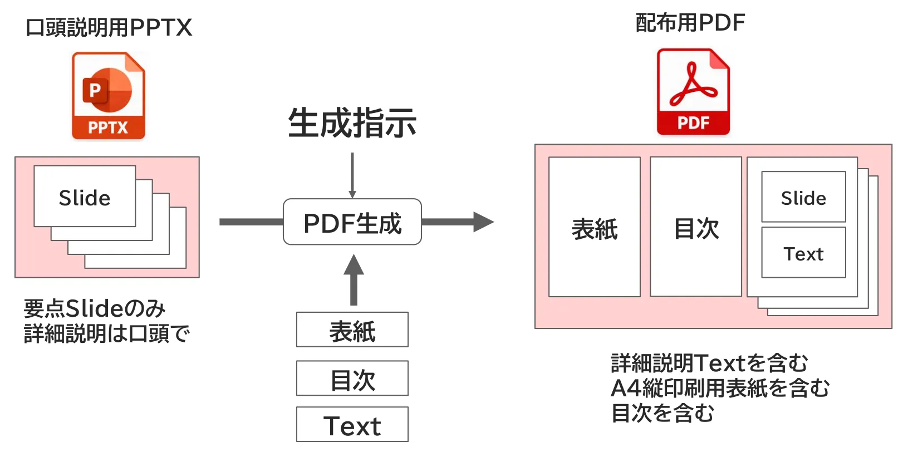


つまり、「読んで理解してね」 という配布用のPDFは、Slide(要点部分)に詳細Text(口頭説明部分)を加えて作らなければならないのです。 そしてこのとき、さらにいろいろとやりたいことが出てきます。

> - プレーンテキストでは物足りない。文字サイズ、フォント、配色などを変えてメリハリをつけられるようにしたい
> - A4縦に印刷したときに読みやすいレイアウトにしたい
> - 表紙をつけたい
> - 章/節番号をつけたい
> - 目次をつけたい

などなど、これらを可能にするのがppt-md-mergerのPDF生成機能です。

PDF生成機能を使うためには口頭説明で使うPPTXの他に、Text、目次、表紙のデータ、およびそれらをどう組み合わせるかを指示する 「生成指示書」 を書く必要があります。

当サンプルは、これらのしくみを解説します。 


<!-- source: ../mds/pdf1_minimum_slide4.md -->
<!-- md_merge_rawtitle: 実際に書くものは note と生成指示書 -->
<!-- #id:section:pdf1_minimum:slide4 -->
## 実際に書くものは note と生成指示書

以後、口頭説明用PPTXのことを原稿PPTXと呼びます（PDFを作るための原稿、という位置づけなので）。

生成指示書は結合指示書またはレシピyamlと呼ぶ場合があります（料理のレシピのような位置づけのファイルをyaml書式で書くからです）。

配布用PDFはターゲットPDFと呼びます（これを生成することが目標である、という意味です）。


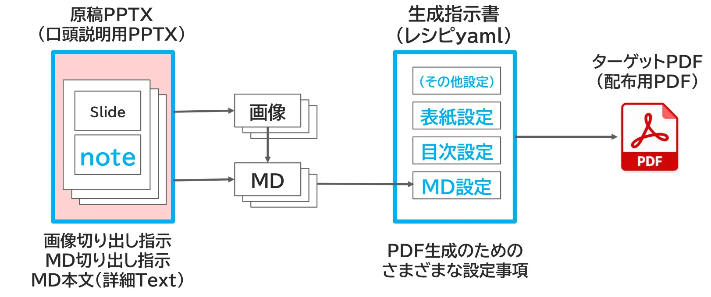


ppt-md-merger を使うために実際に書くものは note と生成指示書です（図中の青枠部分）。

note はPPTXのslideごとに追記できるテキスト領域であり、一般にはslideについての備忘録的なメモを書くために使うものです。 

それに対してppt-md-mergerでは原稿PPTXの各slideのnoteに特殊な書式で

> - slide の一部を画像ファイルとして切り出す指示
> - note の一部をMardownファイル(MDファイル) として切り出す指示
> - 切り出されるMarkdown本文（詳細Textを含む）

を書きます。 その指示を元に1つのPPTXファイルから複数の画像とMDファイルを自動的に切り出します。 MDファイルが画像を参照するように書くので、MDを開くとテキストの中に画像をインクルードした形で表示されます。

生成指示書はyamlフォーマットのテキストファイルで、PDF生成のためのさまざまな設定事項を書きます。 具体的には表紙、目次、MDおよびその他の設定事項です。MD設定はどのMDファイルをどの順番で使うかを示すもので、ppt-md-mergerはこの指示に従ってMDファイルを結合し、表紙と目次を加えてPDF（配布用PDF）を生成します。

実例は下記ファイルにて参照できます。


|         内容      | パス         | ファイル名                                      |
| --------------------------- | -------------------|------------------------------------------------------------------ |
| 口頭説明用PPTX    | src    | pdf1_minimum.pptx |
| 生成指示書   | src    | pdf1_minimum_recipe.yaml |
| 配布用PDF | build    | pdf1_minimum_target.pdf |


<!-- source: ../mds/pdf1_minimum_slide5.md -->
<!-- md_merge_rawtitle: PPTX ファイルの記述方法 -->
<!-- #id:chapter:pdf1_minimum:slide5 -->
# PPTX ファイルの記述方法

> 原稿PPTXファイルのスライド部分とnote部分の記述方法を解説します。


> - 2.1) 画像切り出し： 長方形カット
> - 2.2) MD切り出し
> - 2.3) MDテキスト中での画像参照


<!-- source: ../mds/pdf1_minimum_slide6.md -->
<!-- md_merge_rawtitle: 画像切り出し： 長方形カット -->
<!-- #id:section:pdf1_minimum:slide6 -->
## 画像切り出し： 長方形カット

スライドの画像を切り出すために最もよく使う 「長方形カット」 の方法です。

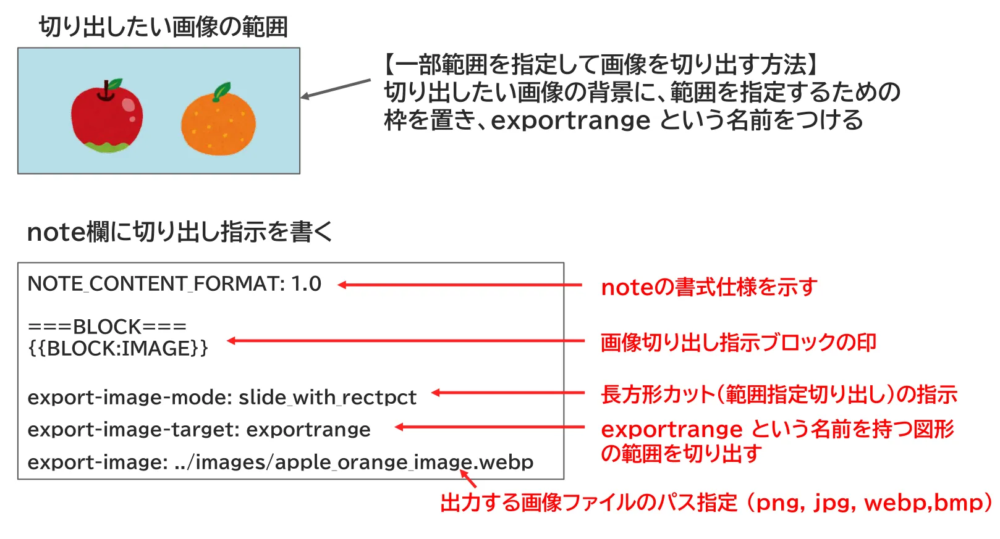

たとえばリンゴとミカンの画像を切り出したいとします。それには切り出したい画像の背景に、長方形の図形を切り出し範囲指定枠として配置し、exportrange (例)という名前をつけます。 名前は後述の export-image-target と合っていれば良いので、任意の名前を使えます。 名前をつけるにはPowerPointのメニューで 「編集→選択」 で図形を選択して名前を変更します。

次いで、スライドnote欄に切り出し指示を書きます。

1行目は NOTE_CONTENT_FORMAT: 1.0 で固定です。 これを書いておくと、 ppt-md-merger が note を解析して画像切り出し等の処理をします。

"===BLOCK===" は指示ブロックの始まり（区切り）を示し、 "{{BLOCK:IMAGE}}" は画像切り出し指示ブロックであることを示します。

"export-image-mode" は範囲を指定するロジックの選択で、 "slide_with_rectpct" は長方形カットであることを示します。 他に slide モード（スライド全体）、named_shape モード（pptx上の1シェイプのみ）があります。

"export-image-target" で、範囲を指定します。この例では "slide_with_rectpct" モードのため、"exportrange という名前を持つシェイプの範囲" で画像を切り出します。上に載っているリンゴとミカンの画像も含めて切り出されます。 "named_shape" モードの場合は "exportrange シェイプのみ" が切り出されるため、別シェイプであるリンゴとミカンは入りません。

"export-image" で、出力する画像ファイル名を指定します。ファイル形式は png, jpg, webp, bmp が使用可能で、拡張子に応じて選択されます。 相対パス指定の場合は .pptx ファイルの場所が基点になります。

↓↓↓切り出された画像ファイルがこちらです。 


<!-- source: ../mds/pdf1_minimum_slide7.md -->
<!-- md_merge_rawtitle: MD切り出し -->
<!-- #id:section:pdf1_minimum:slide7 -->
## MD切り出し

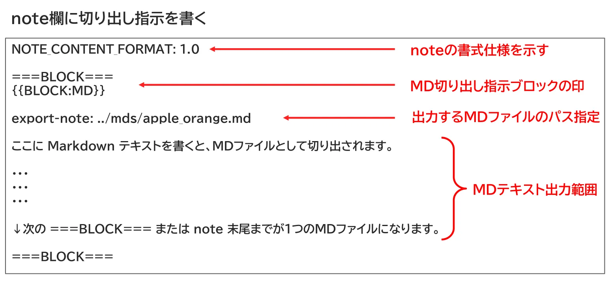

"{{BLOCK:MD}}" を使うと、BLOCKの内容を Markdown ファイルとして出力できます。

"export-note" で、出力するMDファイル名を指定します。 相対パス指定の場合は pptx が基点になります。


<!-- source: ../mds/pdf1_minimum_slide8.md -->
<!-- md_merge_rawtitle: MDテキスト中での画像参照 -->
<!-- #id:section:pdf1_minimum:slide8 -->
## MDテキスト中での画像参照

切り出した画像をMDテキスト中で参照するには、通常の Markdown 記法を使います。


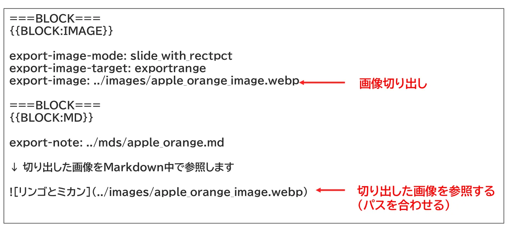


画像ファイルのパスが合っていれば参照可能です。


<!-- source: ../mds/pdf1_minimum_slide9.md -->
<!-- md_merge_rawtitle: レシピyamlの記述方法 -->
<!-- #id:chapter:pdf1_minimum:slide9 -->
# レシピyamlの記述方法

> レシピyaml（生成指示書）の記述方法を解説します。


> - 3.1) 単純PDF化処理イメージ
> - 3.2) 生成指示書解説(1)　表紙データ
> - 3.3) 生成指示書解説(2)　出力ファイル、フォルダ
> - 3.4) 生成指示書解説(3)　結合MD生成処理
> - 3.5) 生成指示書解説(4)　原稿データ
> - 3.6) 生成指示書解説(5)　PDF生成処理-Pandoc 1
> - 3.7) 生成指示書解説(6)　PDF生成処理-Pandoc 2
> - 3.8) 生成指示書解説(7)　個別MD結合処理


<!-- source: ../mds/pdf1_minimum_slide10.md -->
<!-- md_merge_rawtitle: 単純PDF化処理イメージ -->
<!-- #id:section:pdf1_minimum:slide10 -->
## 単純PDF化処理イメージ

レシピyaml の詳細解説を読む前に、まず全体の処理の流れをイメージしてください。

全体としては、図中左上の原稿PPTXファイルをもとにして、右端のターゲットPDFを生成します。その過程がいくつかのサブプロセスに分かれており、レシピyamlの設定項目はそれらのサブプロセスに対応します。


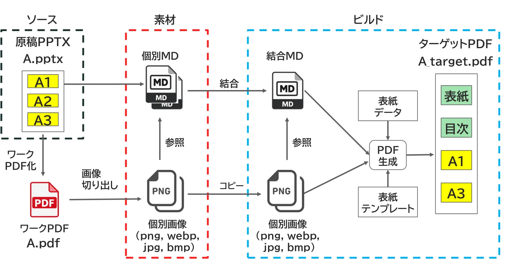


**個別MD**
１スライドごとに、そのスライドに対する詳細説明TextをMarkdownファイルとして切り出します。通常は 「１スライドごとに１個別MD」 という形で運用しますが、技術的には 「１スライドごとに０個以上の個別MD」 を出力可能です。

**ワークPDF**
原稿PPTXをいったんそのままPDF化したものです。画像切り出しはこのワークPDFファイルをもとに行います。

**個別画像**
原稿PPTXのスライドを画像として切り出したものです。スライドの全体またはスライドの一部を指定して切り出します。画像形式はpng、webp、jpg、bmpが使用可能です。

**個別MDから個別画像を参照する**
通常、個別MDの中から個別画像ファイルを参照するようにMDテキストを書きます。

**結合MD**
個別MDを複数集めて結合したものです。どのファイルをどの順番で結合するかはレシピyamlで指定します。 原稿PPTXの一部のスライドを除去してターゲットPDFを作ることもできます。図中ではA2が除去されています。

**コピー**
結合MDは通常、個別MDとは別な場所に出力します。このとき、個別MDが参照している個別画像ファイルを相対パスを保つ形でコピーすることができます。これによってMDファイルと画像ファイルの相対パスが一定に保たれます。

**目次、表紙**
ターゲットPDF生成時に表紙と目次を付加できます。 目次はPDF生成プログラムが結合MDを読んで自動生成します。 表紙は表紙テンプレートを差し込んで表紙データを置換します。

**表紙テンプレート**
タイトル、作者、作成日、表紙画像などの、表紙を構成する情報を 「どの位置にどの大きさで表示する」、のようなレイアウト情報を定義したファイルです。印刷配布するPDF文書を制作する際、A4縦の表紙レイアウトをPowerPointで作るのは難しいため、原稿PPTXとは別に表紙テンプレートを用意して差し込みます。

**表紙データ**
タイトル、作者、作成日、表紙画像などの具体的情報を持つ変数の集合。表紙テンプレートでは変数でレイアウトを定義しています。その変数を表紙データで置き換えることで表紙ができます。

**ソース、素材、ビルドフォルダ**
ファイルを置く場所または生成される場所は大別してソース、素材、ビルドの３箇所あると考えてください。 おおまかに言って、ソースのファイルを使って素材を作り、素材を使ってビルドを作る、という流れです。 当サンプルでは以下のようなフォルダを使用します。

| フォルダ名        | 用途                                                                                                       |
| ------------------- | -------------------------------------------------------------------------------------------------------- |
| src       | ソースフォルダ。原稿PPTX、レシピyaml、表紙テンプレートを置く場所 |
| mds       | 素材フォルダ。原稿PPTXから切り出した個別MDファイルを生成する場所 |
| images       | 素材フォルダ。原稿PPTXから切り出した個別画像ファイルを生成する場所 |
| build       | ビルドフォルダ。結合MDおよびそこから参照する画像、およびそれらを元に生成されるワークファイル、ターゲットPDFを生成する場所 |
| temppdfs       | 原稿PPTXから個別画像ファイルを切り出すために使用するワークPDFファイルを生成する場所 |

個別MDおよび個別画像の出力先は原稿PPTX内の切り出し指示に従います。図では素材フォルダが１箇所であるかのように見えますが、個々のファイルごとに独立して指定できるので、バラバラになることもありえます。しかし自動生成されるファイルですので作業終了後に一括削除しやすいよう、プロジェクトごとにまとめておく運用を推奨します。当サンプルでは個別MD出力用フォルダをmds、個別画像出力用フォルダをimagesとしてまとめてあります。

ワークPDFの出力先はレシピyaml内の指定に従います。当サンプルでは temppdfs という単独のフォルダに出力していますが、用途は個別画像の切り出し用作業ファイルですので、個別画像素材フォルダと同じ場所に出力するのも合理的です。

結合MDおよびそれをもとに生成されるワークファイルやターゲットPDFの出力先はレシピyaml内の指定に従います。

作図の都合上、表紙テンプレートと表紙データをビルドフォルダの中に書いていますが、意味的にはこの両者はソースデータです。当サンプルでは表紙テンプレートはソースフォルダにあり、表紙データはレシピyaml内に記載してあります。

原則としてソースフォルダに全てのソースデータをまとめておき、それ以外のフォルダは自動生成されるファイルのみを置いて、いつでも一括削除可能な形で運用することを推奨します。

当サンプルにおけるソースデータは、以下の３ファイルです。

| フォルダ名                                 | 用途                                                                 |
| --------------------------------- | ----------------------------------------------------------- |
| pdf1_minimum.ppt                 | 原稿PPTX                                                          |
| pdf1_minimum_recipe.yaml    | 生成指示書。レシピyaml （この中に表紙データを含む）    |
| cover_standard_minimum.md | 表紙テンプレート                                                    |


次ページ以後、生成指示レシピyaml、 pdf1_minimum_recipe.yaml の記入例を解説します。


<!-- source: ../mds/pdf1_minimum_slide11.md -->
<!-- md_merge_rawtitle: 生成指示書解説(1) 表紙データ -->
<!-- #id:section:pdf1_minimum:11 -->
## 生成指示書解説(1)　表紙データ

表紙データは変数定義を行う vars: セクションに COVER_* という変数名で記述します。

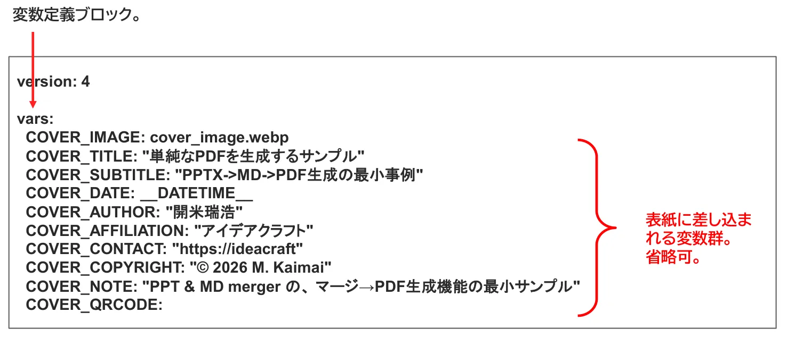

COVER_* は表紙テンプレートが使用する変数で、省略可です。

COVER_IMAGE と COVER_QRCODE には画像ファイルを指定します。


<!-- source: ../mds/pdf1_minimum_slide12.md -->
<!-- md_merge_rawtitle: 生成指示書解説(2) 出力ファイル、フォルダ -->
<!-- #id:section:pdf1_minimum:12 -->
## 生成指示書解説(2)　出力ファイル、フォルダ

output.targetbasefilename: ターゲットPDFの拡張子を除くベース名を指定します。

ワークファイル名はほとんどコメントになっているため、targetbasefilename をもとにした名前が自動付与されます。

output.force: false にすると、自動生成ファイルを上書きするかどうか確認が入ります。

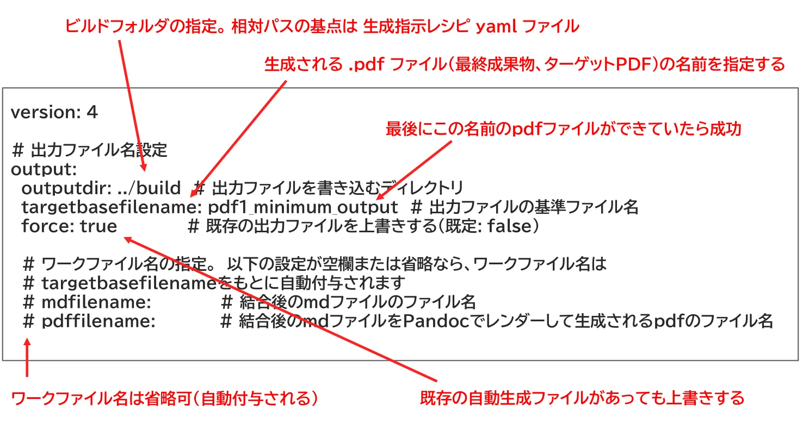


<!-- source: ../mds/pdf1_minimum_slide13.md -->
<!-- md_merge_rawtitle: 生成指示書解説(3) 結合MD生成処理 -->
<!-- #id:section:pdf1_minimum:13 -->
## 生成指示書解説(3)　結合MD生成処理

merge セクションは、結合MDを生成するときの細部の動作を制御します。

copy-images: true の設定により、image-dir に画像ファイルをコピーします。

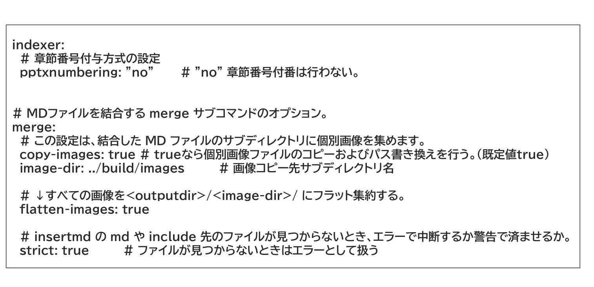

当サンプルでは章節番号付番は行っていません。


<!-- source: ../mds/pdf1_minimum_slide14.md -->
<!-- md_merge_rawtitle: 生成指示書解説(4) 原稿データ -->
<!-- #id:section:pdf1_minimum:14 -->
## 生成指示書解説(4)　原稿データ

input.dirs には、結合対象となる個別MDを探すディレクトリを列挙します。 個別MDは結合MDを作るためのMD部品で、後述の insertmd, insertmdpages 命令で指定します。 ここで個別MDの格納ディレクトリを列挙しておくと、insertmd 命令では個別MDのパスを省略してファイル名のみで書けます。

input.imagesdir には、pptxからの画像切り出し先として使用しているディレクトリを列挙します。この項目は slide_with_rectpct モードで切り出した画像をトリミングするために使われます。

input.cropsrc には、画像/MD切り出しを行う対象となる pptx ファイルを、pptxとpdfのペアで列挙します。複数ある場合はリストにします。pdf項目を省略すると outputdir に作られますが、ターゲットPDFと紛らわしくなることがあるため、それを避けるなら temppdfs などの専用ディレクトリを作って明示します。

処理の流れは、 pptx: 項目に指定された .pptxファイルを pdf: に指定された.pdf に変換し、それをもとにして画像を切り出す、というものです。したがって pptx: 項目のファイルは実在していなければならず、pdf: 項目に指定したファイルは上書きされます。

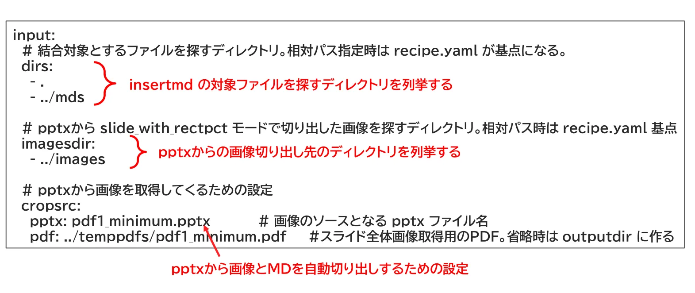

pptx を複数使う場合はリストで記述します。

```
  cropsrc:  # リスト使用可能
    - pptx: 講師紹介_standard.pptx 
      pdf: ../temppdfs/講師紹介_standard.pdf           
    - pptx: ../../modules/src/問題・目標・原因・施策_standard.pptx
      pdf: ../temppdfs/問題・目標・原因・施策_standard.pdf

```


<!-- source: ../mds/pdf1_minimum_slide15.md -->
<!-- md_merge_rawtitle: 生成指示書解説(5) PDF生成処理-Pandoc 1 -->
<!-- #id:section:pdf1_minimum:15 -->
## 生成指示書解説(5)　PDF生成処理-Pandoc 1

pandoc セクションでは、PDF生成に使用するプログラム(Pandoc)関係の項目を設定します。

pandoc.resource-path: にはPDFに埋め込む画像ファイル等を含むディレクトリを設定します。 ただしこの例では例示のため ../build を記載していますが実際は ../build は省略しても動きます。 当サンプルではPDF生成元の結合MDが参照する画像ファイルはすべて結合MDファイルが存在する ../build 以下のディレクトリに集約しているためです。 結合MDが ../build の外の階層にある画像を参照しているときは、そのパスをここに記載します。

pandoc.cover-md: には表紙用テンプレートファイルを指定します。省略すると表紙がつきません。表紙テンプレートのサンプルが src/md_merge/templates/cover_standard.md に同梱されているので、それをコピー＆カスタマイズして使うとよいでしょう。
当サンプルの cover_standard_minimum.md は単純なコピーです。

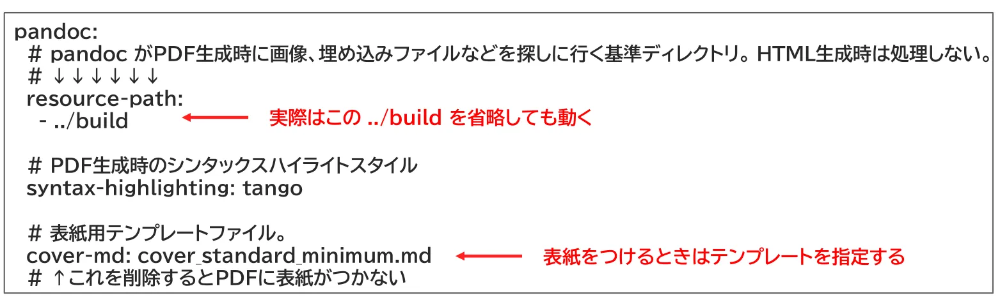


<!-- source: ../mds/pdf1_minimum_slide16.md -->
<!-- md_merge_rawtitle: 生成指示書解説(6) PDF生成処理-Pandoc 2 -->
<!-- #id:section:pdf1_minimum:16 -->
## 生成指示書解説(6)　PDF生成処理-Pandoc 2

**defaults ファイル**
defaults ファイルとは、pandocの基本設定を集めたファイルです。 基本設定は複数の文書に横断的に適用され、長期間変わらないことが多いので、 「defaultで適用される基本設定パターン」 という意味で defaults ファイルと呼ばれます。

defaults ファイルは複数のプロジェクトあるいは複数の会社や業界をまたいで共通のものが使われることも多いため、下記のように個別文書のフォルダとは別フォルダに置いて参照することを推奨します。 

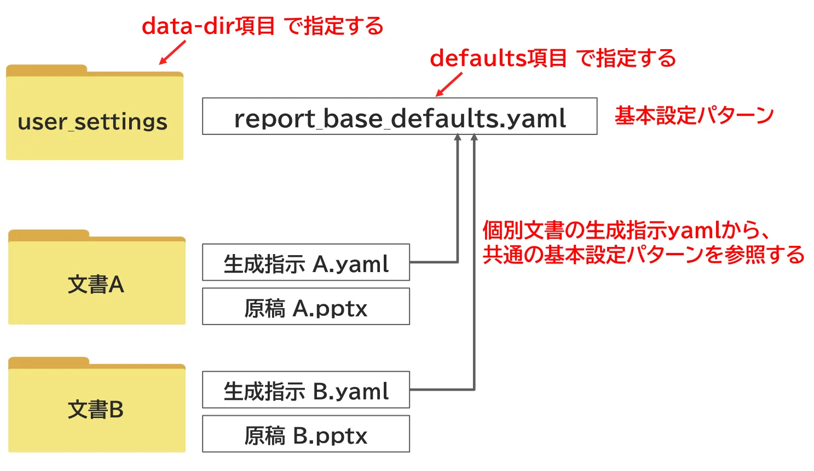

複数の文書で共通に参照する設定ファイルや画像データなどの資材を user_settings フォルダ以下に置きます。それを個別文書フォルダ内の生成指示YAMLから参照します。


以下、実際の設定例です。 data-dir: でuser_settingsフォルダを指定し、defaults: で defaults ファイルを指定します。

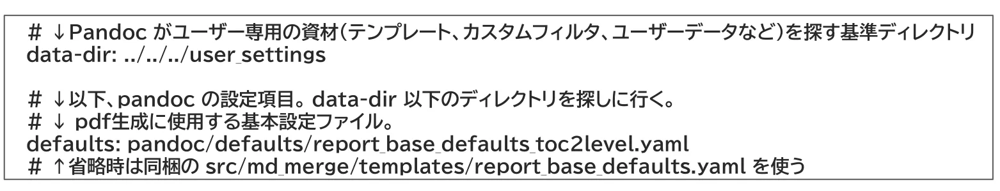

defaultsファイルをカスタマイズする場合は、ppt-md-merger 同梱のファイルをコピーして専用のディレクトリに保存し、その場所を data-dir: , defaults: で指定してください。

当サンプルが使用している report_base_defaults_toc2level.yaml は、同梱の基本設定ファイルである src/md_merge/templates/report_base_defaults.yaml をコピーして、目次レベルを2に変えたものです。


<!-- source: ../mds/pdf1_minimum_slide17.md -->
<!-- md_merge_rawtitle: 生成指示書解説(7) 個別MD結合処理 -->
<!-- #id:section:pdf1_minimum:17 -->
## 生成指示書解説(7)　個別MD結合処理

procedure: セクションでは、MDファイルやPPTXファイルの結合指示を行います。 （当サンプルではMDファイルの結合のみを使用）

insertmd 命令で個別MDファイルの挿入を指示します。 ppt-md-mergerは個別MDファイルを記載した順番に結合して、結合MDファイルを出力します。

insertvfill はページの余白を空白で埋める命令、 insertpagebreak は改ページ命令です。 通常、この2つをセットで insertvfill, insertpagebreak の順に使用します。 個別MDのコンテンツが短い場合、後に vfill, pagebreak を置くことによって、残りを空白にして改ページされます。 vfill なしで pagebreak だけを使うとページの中段にコンテンツが表示されて不自然になります。

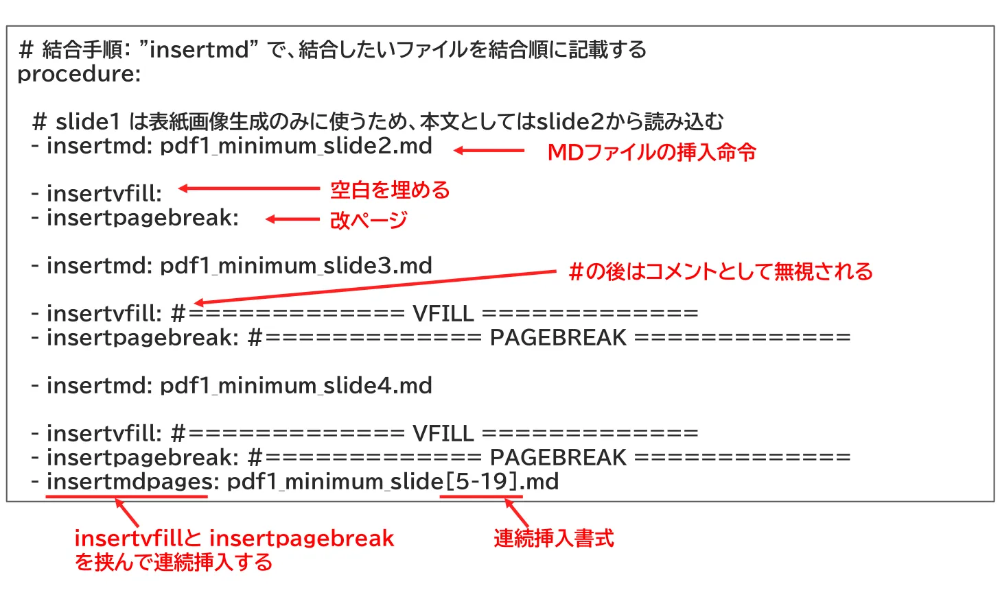

個別MDファイルは pdf1_minimum_slide4.md のように途中にスライド番号の数字を含む一定のファイル名パターンで生成することが多く、それらを連続して挿入する場合は連続挿入書式が使えます。 ファイル名の途中で [a-b] という表記を挟むと、数字をaからbまで増やしてすべて挿入します。

連続挿入する際、insertmdpages を使うと、間に自動的に insertvfill と insertpagebreak が挟まれます。 MDファイルごとに改ページをするときに便利な記法です。


<!-- source: ../mds/pdf1_minimum_slide18.md -->
<!-- md_merge_rawtitle: 生成コマンド実行方法 -->
<!-- #id:chapter:pdf1_minimum:slide18 -->
# 生成コマンド実行方法

> PDF生成コマンドの実行方法とフォルダ構成を解説します。


> - 4.1) pdf1_minimum 生成方法
> - 4.2) pdf1_minimum フォルダの構成


<!-- source: ../mds/pdf1_minimum_slide19.md -->
<!-- md_merge_rawtitle: pdf1_minimum 生成方法 -->
<!-- #id:section:pdf1_minimum:slide2 -->
## pdf1_minimum 生成方法

examples\\pdf1_minimum フォルダのサンプル一式を参照してください。


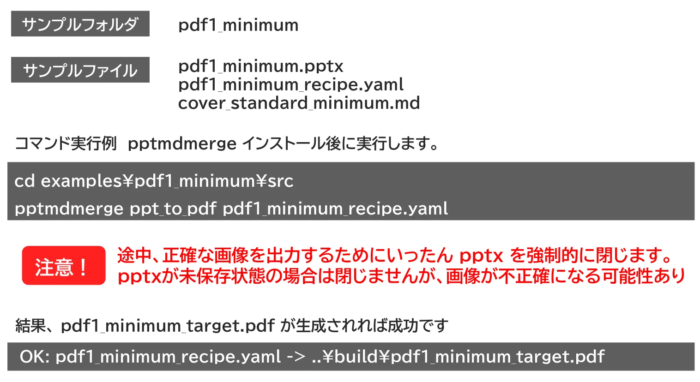


### 実行命令

以下の命令で実行します。サブコマンド pptmerge の引数に生成指示書を指定します。

```bash
cd examples\pdf1_minimum\src
pptmdmerge ppt_to_pdf pdf1_minimum_recipe.yaml
```

成果物は

PDFファイル： build/pdf1_minimum_target.pdf

です。　その他に、

```bash
pptmdmerge ppt_to_puremd src/pdf1_minimum_pdf_recipe.yaml --keep-work
```
で、

MDファイル： build/pdf1_minimum_target_puremd.md

を生成します。PDFではなくMDで配付したい場合はこれをbuild/images ディレクトリとともに配付します。

```bash
pptmdmerge ppt_to_githubmd src/pdf1_minimum_pdf_recipe.yaml --keep-work
```
で、

GitHub 仕様のMDファイル： build/pdf1_minimum_target_github.md

を生成します。


<!-- source: ../mds/pdf1_minimum_slide20.md -->
<!-- md_merge_rawtitle: pdf1_minimum フォルダの構成 -->
<!-- #id:section:pdf1_minimum:20 -->
## pdf1_minimum フォルダの構成

pdf1_minimum フォルダの構成です


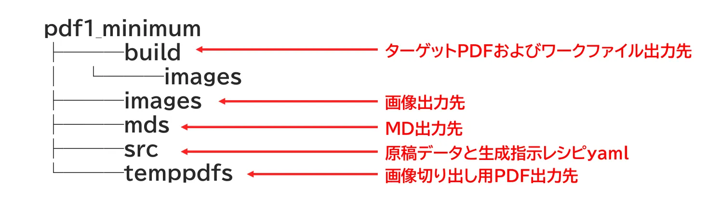


| 項目         | 説明                                                                                                       |
| ------------------- | -------------------------------------------------------------------------------------------------------- |
| src      | 原稿と生成指示レシピyaml等を格納。このフォルダ以外は削除しても自動生成される |
| temppdfs     | 画像切り出し用PDFの出力先。作業フォルダであり通常は見る必要なし |
| mds     | MDファイルの出力先。作業フォルダであり通常は見る必要なし |
| images     | 画像ファイルの出力先。作業フォルダであり通常は見る必要なし |
| build     | ここにターゲットPDFが出力される。 他に、ログファイルやワークファイルもここに出る |

この構成は運用方法の一例です。

設定のデバッグを容易にするために src, temppdfs, mds, images, build を分けています。

src以外のフォルダは自動生成されるため、削除可能です。

MDファイルはいったん mds に生成してから、結合MDを build に出力します。

画像ファイルもいったん images に出力してから build/images フォルダにコピーし、それを結合MDがincludeします。

ターゲットPDFは結合MDをもとに build フォルダに出力します。

PDFではなく結合MDを後工程で利用する場合は、build フォルダごとコピーすれば、必要な画像一式を含む形で後工程に渡せます。