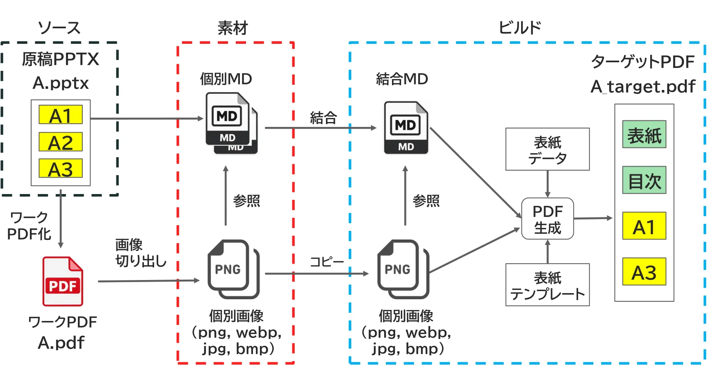

<!-- md_merge_rawtitle: 単純PDF化処理イメージ -->
{{#id:section:pdf1_minimum:slide10}}
## 単純PDF化処理イメージ

レシピyaml の詳細解説を読む前に、まず全体の処理の流れをイメージしてください。

全体としては、図中左上の原稿PPTXファイルをもとにして、右端のターゲットPDFを生成します。その過程がいくつかのサブプロセスに分かれており、レシピyamlの設定項目はそれらのサブプロセスに対応します。

{{vspace:1}}

::: {.center}

{ width=100% }

:::

{{vspace:1}}

[個別MD]{.term}
１スライドごとに、そのスライドに対する詳細説明TextをMarkdownファイルとして切り出します。通常は 「１スライドごとに１個別MD」 という形で運用しますが、技術的には 「１スライドごとに０個以上の個別MD」 を出力可能です。

[ワークPDF]{.term}
原稿PPTXをいったんそのままPDF化したものです。画像切り出しはこのワークPDFファイルをもとに行います。

[個別画像]{.term}
原稿PPTXのスライドを画像として切り出したものです。スライドの全体またはスライドの一部を指定して切り出します。画像形式はpng、webp、jpg、bmpが使用可能です。

[個別MDから個別画像を参照する]{.term}
通常、個別MDの中から個別画像ファイルを参照するようにMDテキストを書きます。

[結合MD]{.term}
個別MDを複数集めて結合したものです。どのファイルをどの順番で結合するかはレシピyamlで指定します。 原稿PPTXの一部のスライドを除去してターゲットPDFを作ることもできます。図中ではA2が除去されています。

[コピー]{.term}
結合MDは通常、個別MDとは別な場所に出力します。このとき、個別MDが参照している個別画像ファイルを相対パスを保つ形でコピーすることができます。これによってMDファイルと画像ファイルの相対パスが一定に保たれます。

[目次、表紙]{.term}
ターゲットPDF生成時に表紙と目次を付加できます。 目次はPDF生成プログラムが結合MDを読んで自動生成します。 表紙は表紙テンプレートを差し込んで表紙データを置換します。

[表紙テンプレート]{.term}
タイトル、作者、作成日、表紙画像などの、表紙を構成する情報を 「どの位置にどの大きさで表示する」、のようなレイアウト情報を定義したファイルです。印刷配布するPDF文書を制作する際、A4縦の表紙レイアウトをPowerPointで作るのは難しいため、原稿PPTXとは別に表紙テンプレートを用意して差し込みます。

[表紙データ]{.term}
タイトル、作者、作成日、表紙画像などの具体的情報を持つ変数の集合。表紙テンプレートでは変数でレイアウトを定義しています。その変数を表紙データで置き換えることで表紙ができます。

[ソース、素材、ビルドフォルダ]{.term}
ファイルを置く場所または生成される場所は大別してソース、素材、ビルドの３箇所あると考えてください。 おおまかに言って、ソースのファイルを使って素材を作り、素材を使ってビルドを作る、という流れです。 当サンプルでは以下のようなフォルダを使用します。

| フォルダ名        | 用途                                                                                                       |
| ------------------- | -------------------------------------------------------------------------------------------------------- |
| src       | ソースフォルダ。原稿PPTX、レシピyaml、表紙テンプレートを置く場所 |
| mds       | 素材フォルダ。原稿PPTXから切り出した個別MDファイルを生成する場所 |
| images       | 素材フォルダ。原稿PPTXから切り出した個別画像ファイルを生成する場所 |
| build       | ビルドフォルダ。結合MDおよびそこから参照する画像、およびそれらを元に生成されるワークファイル、ターゲットPDFを生成する場所 |
| temppdfs       | 原稿PPTXから個別画像ファイルを切り出すために使用するワークPDFファイルを生成する場所 |

個別MDおよび個別画像の出力先は原稿PPTX内の切り出し指示に従います。図では素材フォルダが１箇所であるかのように見えますが、個々のファイルごとに独立して指定できるので、バラバラになることもありえます。しかし自動生成されるファイルですので作業終了後に一括削除しやすいよう、プロジェクトごとにまとめておく運用を推奨します。当サンプルでは個別MD出力用フォルダをmds、個別画像出力用フォルダをimagesとしてまとめてあります。

ワークPDFの出力先はレシピyaml内の指定に従います。当サンプルでは temppdfs という単独のフォルダに出力していますが、用途は個別画像の切り出し用作業ファイルですので、個別画像素材フォルダと同じ場所に出力するのも合理的です。

結合MDおよびそれをもとに生成されるワークファイルやターゲットPDFの出力先はレシピyaml内の指定に従います。

作図の都合上、表紙テンプレートと表紙データをビルドフォルダの中に書いていますが、意味的にはこの両者はソースデータです。当サンプルでは表紙テンプレートはソースフォルダにあり、表紙データはレシピyaml内に記載してあります。

原則としてソースフォルダに全てのソースデータをまとめておき、それ以外のフォルダは自動生成されるファイルのみを置いて、いつでも一括削除可能な形で運用することを推奨します。

当サンプルにおけるソースデータは、以下の３ファイルです。

| フォルダ名                                 | 用途                                                                 |
| --------------------------------- | ----------------------------------------------------------- |
| pdf1_minimum.ppt                 | 原稿PPTX                                                          |
| pdf1_minimum_recipe.yaml    | 生成指示書。レシピyaml （この中に表紙データを含む）    |
| cover_standard_minimum.md | 表紙テンプレート                                                    |

{{vspace:3}}

次ページ以後、生成指示レシピyaml、 pdf1_minimum_recipe.yaml の記入例を解説します。