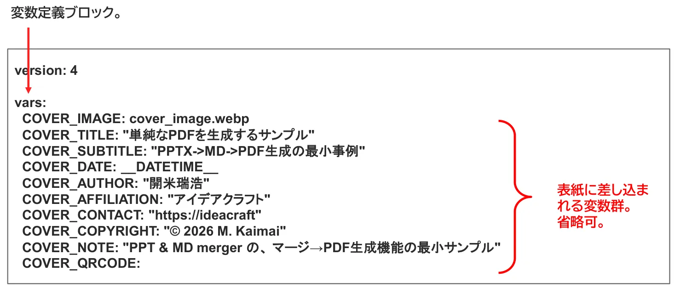

<!-- md_merge_rawtitle: 生成指示書解説(1) 表紙データ -->
{{#id:section:pdf1_minimum:11}}
## 生成指示書解説(1)　表紙データ

表紙データは変数定義を行う vars: セクションに COVER_* という変数名で記述します。

::: {.center}

{ width=100% }

:::

COVER_* は表紙テンプレートが使用する変数で、省略可です。

COVER_IMAGE と COVER_QRCODE には画像ファイルを指定します。