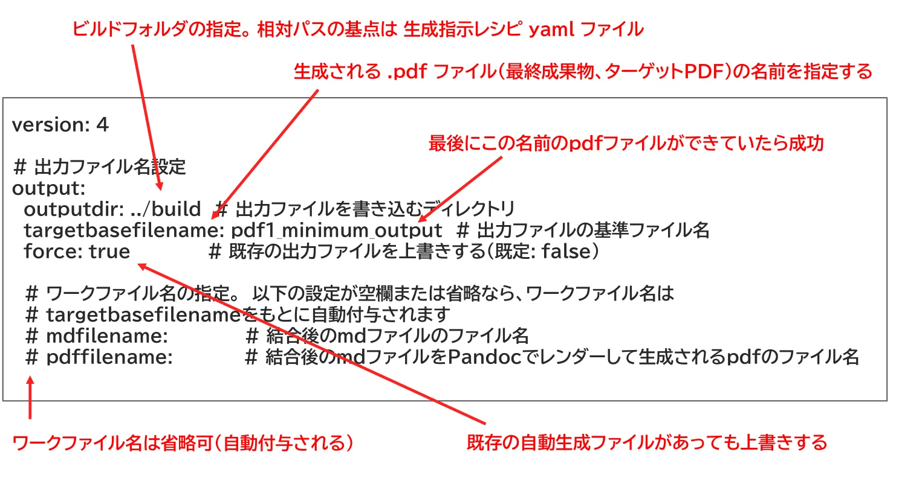

<!-- md_merge_rawtitle: 生成指示書解説(2) 出力ファイル、フォルダ -->
{{#id:section:pdf1_minimum:12}}
## 生成指示書解説(2)　出力ファイル、フォルダ

output.targetbasefilename: ターゲットPDFの拡張子を除くベース名を指定します。

ワークファイル名はほとんどコメントになっているため、targetbasefilename をもとにした名前が自動付与されます。

output.force: false にすると、自動生成ファイルを上書きするかどうか確認が入ります。

::: {.center}

{ width=100% }

:::