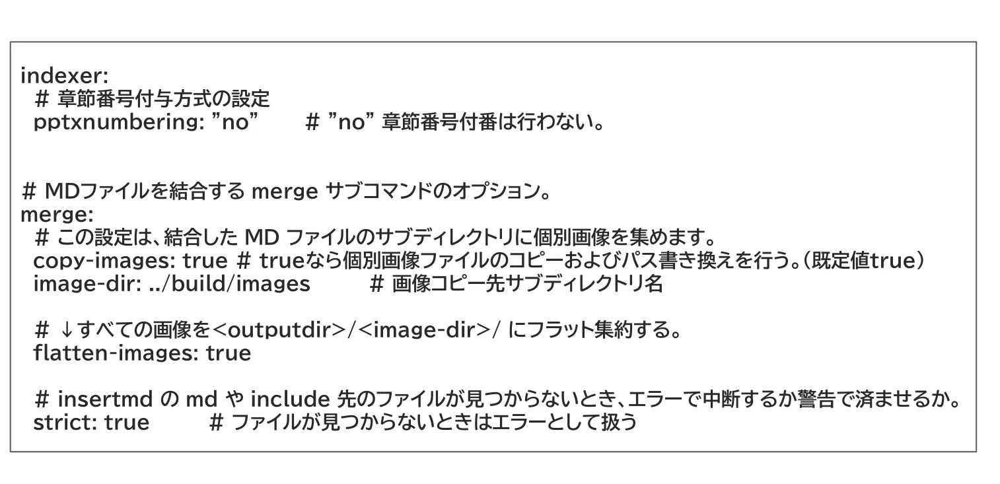

<!-- md_merge_rawtitle: 生成指示書解説(3) 結合MD生成処理 -->
{{#id:section:pdf1_minimum:13}}
## 生成指示書解説(3)　結合MD生成処理

merge セクションは、結合MDを生成するときの細部の動作を制御します。

copy-images: true の設定により、image-dir に画像ファイルをコピーします。

::: {.center}

{ width=100% }

:::

当サンプルでは章節番号付番は行っていません。