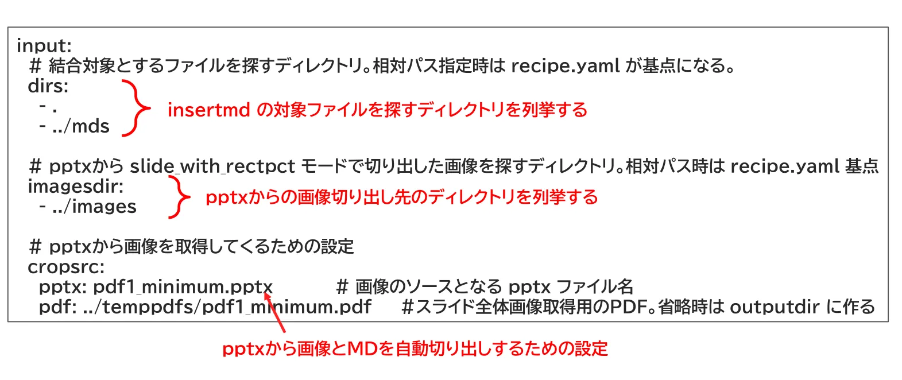

<!-- md_merge_rawtitle: 生成指示書解説(4) 原稿データ -->
{{#id:section:pdf1_minimum:14}}
## 生成指示書解説(4)　原稿データ

input.dirs には、結合対象となる個別MDを探すディレクトリを列挙します。 個別MDは結合MDを作るためのMD部品で、後述の insertmd, insertmdpages 命令で指定します。 ここで個別MDの格納ディレクトリを列挙しておくと、insertmd 命令では個別MDのパスを省略してファイル名のみで書けます。

input.imagesdir には、pptxからの画像切り出し先として使用しているディレクトリを列挙します。この項目は slide_with_rectpct モードで切り出した画像をトリミングするために使われます。

input.cropsrc には、画像/MD切り出しを行う対象となる pptx ファイルを、pptxとpdfのペアで列挙します。複数ある場合はリストにします。pdf項目を省略すると outputdir に作られますが、ターゲットPDFと紛らわしくなることがあるため、それを避けるなら temppdfs などの専用ディレクトリを作って明示します。

処理の流れは、 pptx: 項目に指定された .pptxファイルを pdf: に指定された.pdf に変換し、それをもとにして画像を切り出す、というものです。したがって pptx: 項目のファイルは実在していなければならず、pdf: 項目に指定したファイルは上書きされます。

::: {.center}

{ width=100% }

:::

pptx を複数使う場合はリストで記述します。

```
  cropsrc:  # リスト使用可能
    - pptx: 講師紹介_standard.pptx 
      pdf: ../temppdfs/講師紹介_standard.pdf           
    - pptx: ../../modules/src/問題・目標・原因・施策_standard.pptx
      pdf: ../temppdfs/問題・目標・原因・施策_standard.pdf

```