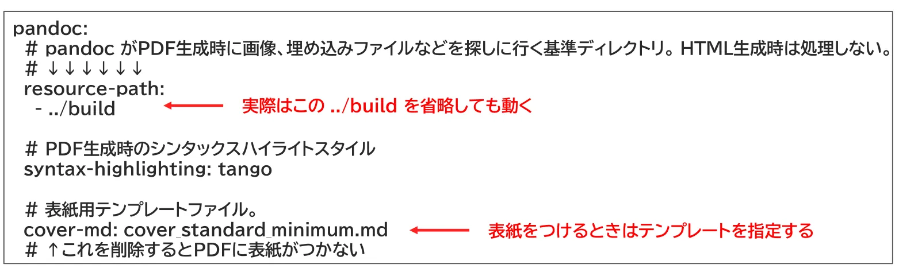

<!-- md_merge_rawtitle: 生成指示書解説(5) PDF生成処理-Pandoc 1 -->
{{#id:section:pdf1_minimum:15}}
## 生成指示書解説(5)　PDF生成処理-Pandoc 1

pandoc セクションでは、PDF生成に使用するプログラム(Pandoc)関係の項目を設定します。

pandoc.resource-path: にはPDFに埋め込む画像ファイル等を含むディレクトリを設定します。 ただしこの例では例示のため ../build を記載していますが実際は ../build は省略しても動きます。 当サンプルではPDF生成元の結合MDが参照する画像ファイルはすべて結合MDファイルが存在する ../build 以下のディレクトリに集約しているためです。 結合MDが ../build の外の階層にある画像を参照しているときは、そのパスをここに記載します。

pandoc.cover-md: には表紙用テンプレートファイルを指定します。省略すると表紙がつきません。表紙テンプレートのサンプルが src/md_merge/templates/cover_standard.md に同梱されているので、それをコピー＆カスタマイズして使うとよいでしょう。
当サンプルの cover_standard_minimum.md は単純なコピーです。

::: {.center}

{ width=100% }

:::