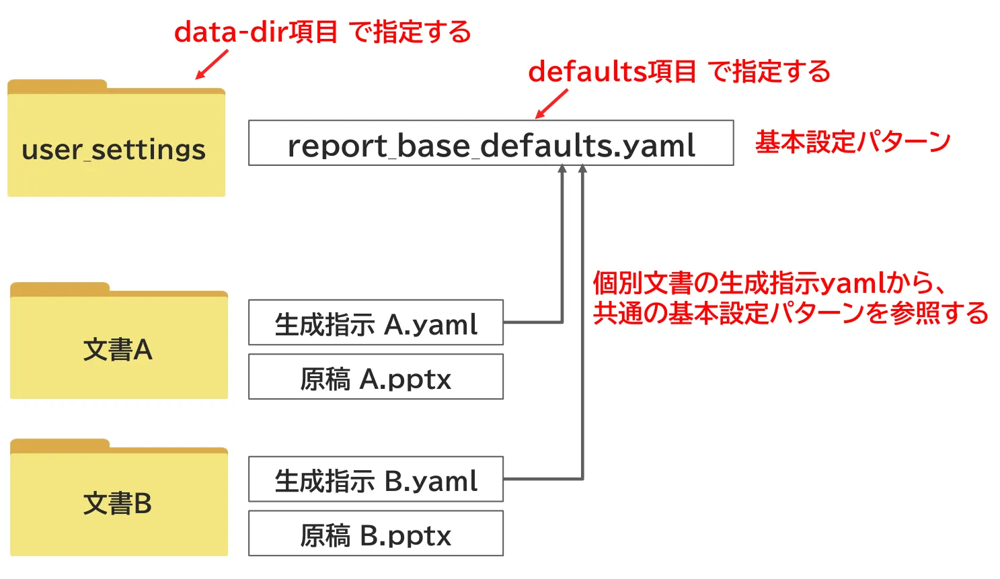
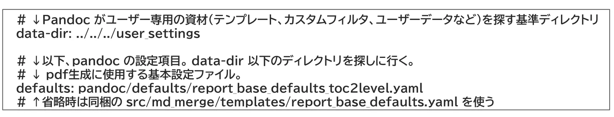

<!-- md_merge_rawtitle: 生成指示書解説(6) PDF生成処理-Pandoc 2 -->
{{#id:section:pdf1_minimum:16}}
## 生成指示書解説(6)　PDF生成処理-Pandoc 2

[defaults ファイル]{.term}
defaults ファイルとは、pandocの基本設定を集めたファイルです。 基本設定は複数の文書に横断的に適用され、長期間変わらないことが多いので、 「defaultで適用される基本設定パターン」 という意味で defaults ファイルと呼ばれます。

defaults ファイルは複数のプロジェクトあるいは複数の会社や業界をまたいで共通のものが使われることも多いため、下記のように個別文書のフォルダとは別フォルダに置いて参照することを推奨します。 

::: {.center}

{ width=80% }

:::

複数の文書で共通に参照する設定ファイルや画像データなどの資材を user_settings フォルダ以下に置きます。それを個別文書フォルダ内の生成指示YAMLから参照します。

{{vspace:1}}

以下、実際の設定例です。 data-dir: でuser_settingsフォルダを指定し、defaults: で defaults ファイルを指定します。

::: {.center}

{ width=100% }

:::

defaultsファイルをカスタマイズする場合は、ppt-md-merger 同梱のファイルをコピーして専用のディレクトリに保存し、その場所を data-dir: , defaults: で指定してください。

当サンプルが使用している report_base_defaults_toc2level.yaml は、同梱の基本設定ファイルである src/md_merge/templates/report_base_defaults.yaml をコピーして、目次レベルを2に変えたものです。