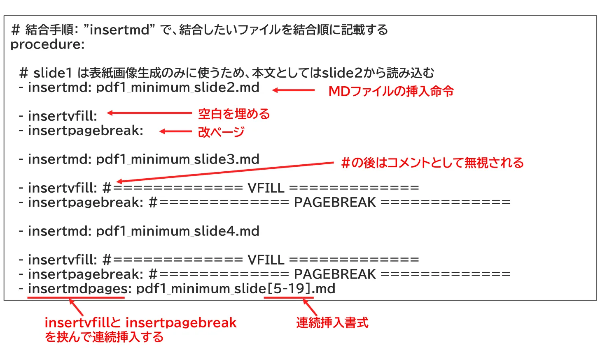

<!-- md_merge_rawtitle: 生成指示書解説(7) 個別MD結合処理 -->
{{#id:section:pdf1_minimum:17}}
## 生成指示書解説(7)　個別MD結合処理

procedure: セクションでは、MDファイルやPPTXファイルの結合指示を行います。 （当サンプルではMDファイルの結合のみを使用）

insertmd 命令で個別MDファイルの挿入を指示します。 ppt-md-mergerは個別MDファイルを記載した順番に結合して、結合MDファイルを出力します。

insertvfill はページの余白を空白で埋める命令、 insertpagebreak は改ページ命令です。 通常、この2つをセットで insertvfill, insertpagebreak の順に使用します。 個別MDのコンテンツが短い場合、後に vfill, pagebreak を置くことによって、残りを空白にして改ページされます。 vfill なしで pagebreak だけを使うとページの中段にコンテンツが表示されて不自然になります。

::: {.center}
{ width=100% }
:::

個別MDファイルは pdf1_minimum_slide4.md のように途中にスライド番号の数字を含む一定のファイル名パターンで生成することが多く、それらを連続して挿入する場合は連続挿入書式が使えます。 ファイル名の途中で [a-b] という表記を挟むと、数字をaからbまで増やしてすべて挿入します。

連続挿入する際、insertmdpages を使うと、間に自動的に insertvfill と insertpagebreak が挟まれます。 MDファイルごとに改ページをするときに便利な記法です。