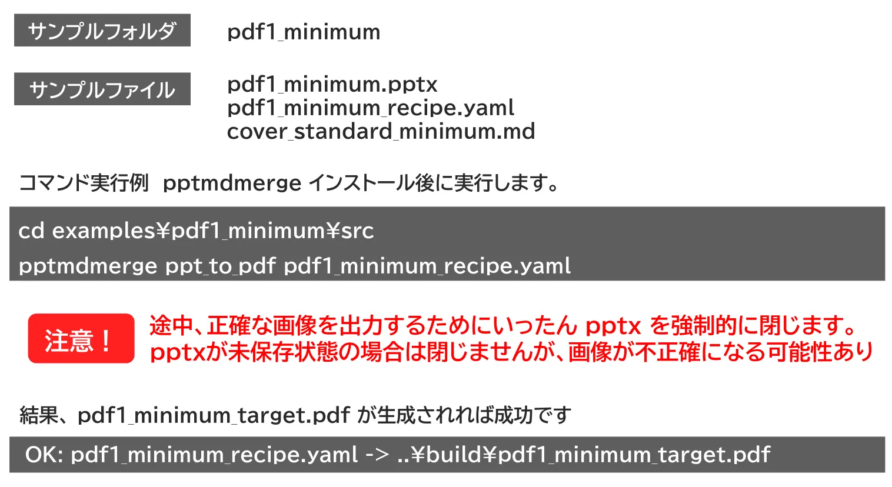

<!-- md_merge_rawtitle: pdf1_minimum 生成方法 -->
{{#id:section:pdf1_minimum:slide2}}
## pdf1_minimum 生成方法

examples\\pdf1_minimum フォルダのサンプル一式を参照してください。

{{vspace:1}}

{ width=100% }

{{vspace:2}}

### 実行命令

以下の命令で実行します。サブコマンド pptmerge の引数に生成指示書を指定します。

```bash
cd examples\pdf1_minimum\src
pptmdmerge ppt_to_pdf pdf1_minimum_recipe.yaml
```

結果、build フォルダに pdf1_minimum_target.pdf が生成されれば成功です。