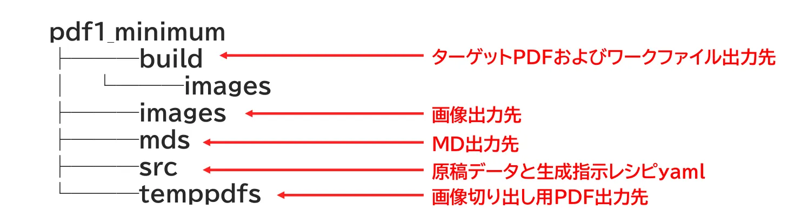

<!-- md_merge_rawtitle: pdf1_minimum フォルダの構成 -->
{{#id:section:pdf1_minimum:20}}
## pdf1_minimum フォルダの構成

pdf1_minimum フォルダの構成です

{{vspace:1}}

{ width=100% }

{{vspace:2}}

| 項目         | 説明                                                                                                       |
| ------------------- | -------------------------------------------------------------------------------------------------------- |
| src      | 原稿と生成指示レシピyaml等を格納。このフォルダ以外は削除しても自動生成される |
| temppdfs     | 画像切り出し用PDFの出力先。作業フォルダであり通常は見る必要なし |
| mds     | MDファイルの出力先。作業フォルダであり通常は見る必要なし |
| images     | 画像ファイルの出力先。作業フォルダであり通常は見る必要なし |
| build     | ここにターゲットPDFが出力される。 他に、ログファイルやワークファイルもここに出る |

この構成は運用方法の一例です。

設定のデバッグを容易にするために src, temppdfs, mds, images, build を分けています。

src以外のフォルダは自動生成されるため、削除可能です。

MDファイルはいったん mds に生成してから、結合MDを build に出力します。

画像ファイルもいったん images に出力してから build/images フォルダにコピーし、それを結合MDがincludeします。

ターゲットPDFは結合MDをもとに build フォルダに出力します。

PDFではなく結合MDを後工程で利用する場合は、build フォルダごとコピーすれば、必要な画像一式を含む形で後工程に渡せます。