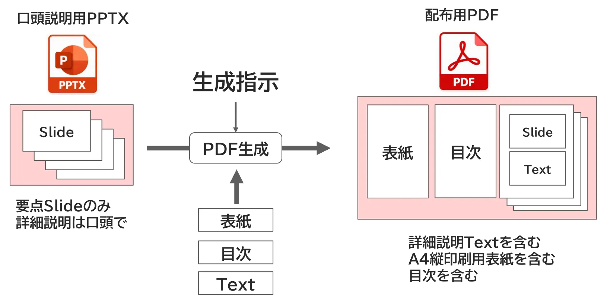

<!-- md_merge_rawtitle: PPTXをもとにPDFを生成するサンプル -->
{{#id:section:pdf1_minimum:slide3}}
## PPTXをもとにPDFを生成するサンプル

PowerPoint を使って説明会・講習会等を行う場合、そこで作る PPTX ファイルはたいてい 「口頭で詳細説明を加えることを前提」 にして、要点のみを記載したSlideになっています。

しかし、いつでも口頭説明ができるわけではなく、資料のみ渡して 「読んで理解してほしい」 というときもあります。 その場合はPPTXをPDFに変換したり印刷して渡すことが多いですが、 「細かい話は口頭で補うのが前提」 のPPTXをそのままPDF化して渡したのでは、たいてい情報量が足りません。 きちんと理解されるようにするためには、口頭説明部分も加えて資料化する必要があります。

{{vspace:1}}

::: {.center}
{ width=100% }
:::

{{vspace:1}}

つまり、「読んで理解してね」 という配布用のPDFは、Slide(要点部分)に詳細Text(口頭説明部分)を加えて作らなければならないのです。 そしてこのとき、さらにいろいろとやりたいことが出てきます。

::: {.blockindent indent=2em}
- プレーンテキストでは物足りない。文字サイズ、フォント、配色などを変えてメリハリをつけられるようにしたい
- A4縦に印刷したときに読みやすいレイアウトにしたい
- 表紙をつけたい
- 章/節番号をつけたい
- 目次をつけたい
:::

などなど、これらを可能にするのがppt-md-mergerのPDF生成機能です。

PDF生成機能を使うためには口頭説明で使うPPTXの他に、Text、目次、表紙のデータ、およびそれらをどう組み合わせるかを指示する 「生成指示書」 を書く必要があります。

当サンプルは、これらのしくみを解説します。 