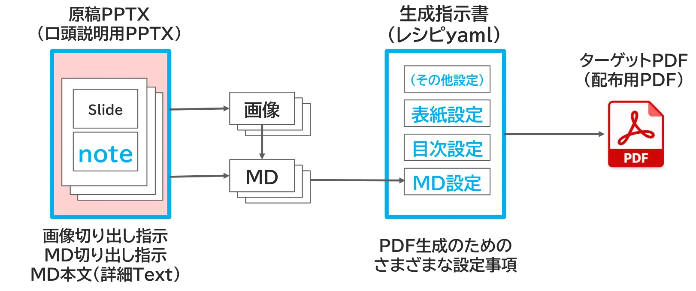

<!-- md_merge_rawtitle: 実際に書くものは note と生成指示書 -->
{{#id:section:pdf1_minimum:slide4}}
## 実際に書くものは note と生成指示書

以後、口頭説明用PPTXのことを原稿PPTXと呼びます（PDFを作るための原稿、という位置づけなので）。

生成指示書は結合指示書またはレシピyamlと呼ぶ場合があります（料理のレシピのような位置づけのファイルをyaml書式で書くからです）。

配布用PDFはターゲットPDFと呼びます（これを生成することが目標である、という意味です）。

{{vspace:1}}

::: {.center}
{ width=100% }
:::

{{vspace:1}}

ppt-md-merger を使うために実際に書くものは note と生成指示書です（図中の青枠部分）。

note はPPTXのslideごとに追記できるテキスト領域であり、一般にはslideについての備忘録的なメモを書くために使うものです。 

それに対してppt-md-mergerでは原稿PPTXの各slideのnoteに特殊な書式で

::: {.blockindent indent=2em}
- slide の一部を画像ファイルとして切り出す指示
- note の一部をMardownファイル(MDファイル) として切り出す指示
- 切り出されるMarkdown本文（詳細Textを含む）
:::

を書きます。 その指示を元に1つのPPTXファイルから複数の画像とMDファイルを自動的に切り出します。 MDファイルが画像を参照するように書くので、MDを開くとテキストの中に画像をインクルードした形で表示されます。

生成指示書はyamlフォーマットのテキストファイルで、PDF生成のためのさまざまな設定事項を書きます。 具体的には表紙、目次、MDおよびその他の設定事項です。MD設定はどのMDファイルをどの順番で使うかを示すもので、ppt-md-mergerはこの指示に従ってMDファイルを結合し、表紙と目次を加えてPDF（配布用PDF）を生成します。

実例は下記ファイルにて参照できます。

|         内容      | パス         | ファイル名                                      |
| --------------------------- | -------------------|------------------------------------------------------------------ |
| 口頭説明用PPTX    | src    | pdf1_minimum.pptx |
| 生成指示書   | src    | pdf1_minimum_recipe.yaml |
| 配布用PDF | build    | pdf1_minimum_target.pdf |