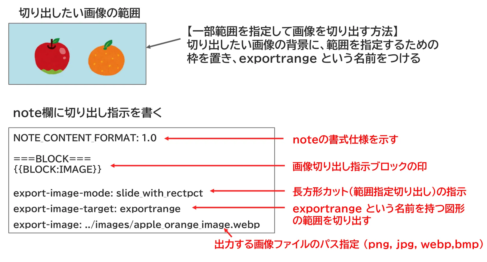
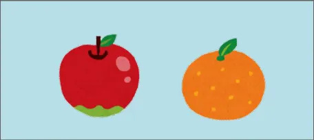

<!-- md_merge_rawtitle: 画像切り出し： 長方形カット -->
{{#id:section:pdf1_minimum:slide6}}
## 画像切り出し： 長方形カット

スライドの画像を切り出すために最もよく使う 「長方形カット」 の方法です。

::: {.center}
{ width=100% }
:::

たとえばリンゴとミカンの画像を切り出したいとします。それには切り出したい画像の背景に、長方形の図形を切り出し範囲指定枠として配置し、exportrange (例)という名前をつけます。 名前は後述の export-image-target と合っていれば良いので、任意の名前を使えます。 名前をつけるにはPowerPointのメニューで 「編集→選択」 で図形を選択して名前を変更します。

次いで、スライドnote欄に切り出し指示を書きます。

1行目は NOTE_CONTENT_FORMAT: 1.0 で固定です。 これを書いておくと、 ppt-md-merger が note を解析して画像切り出し等の処理をします。

"===BLOCK===" は指示ブロックの始まり（区切り）を示し、 "{{BLOCK:IMAGE}}" は画像切り出し指示ブロックであることを示します。

"export-image-mode" は範囲を指定するロジックの選択で、 "slide_with_rectpct" は長方形カットであることを示します。 他に slide モード（スライド全体）、named_shape モード（pptx上の1シェイプのみ）があります。

"export-image-target" で、範囲を指定します。この例では "slide_with_rectpct" モードのため、"exportrange という名前を持つシェイプの範囲" で画像を切り出します。上に載っているリンゴとミカンの画像も含めて切り出されます。 "named_shape" モードの場合は "exportrange シェイプのみ" が切り出されるため、別シェイプであるリンゴとミカンは入りません。

"export-image" で、出力する画像ファイル名を指定します。ファイル形式は png, jpg, webp, bmp が使用可能で、拡張子に応じて選択されます。 相対パス指定の場合は .pptx ファイルの場所が基点になります。

↓↓↓切り出された画像ファイルがこちらです。 

{{vspace:1}}

{ width=30% }

{{vspace:1}}