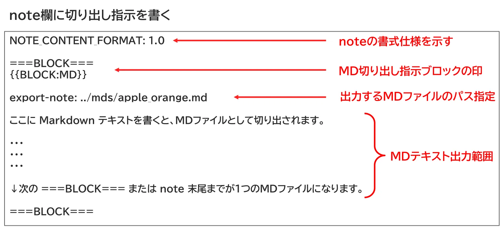

<!-- md_merge_rawtitle: MD切り出し -->
{{#id:section:pdf1_minimum:slide7}}
## MD切り出し

::: {.center}
{ width=100% }
:::

"{{BLOCK:MD}}" を使うと、BLOCKの内容を Markdown ファイルとして出力できます。

"export-note" で、出力するMDファイル名を指定します。 相対パス指定の場合は pptx が基点になります。