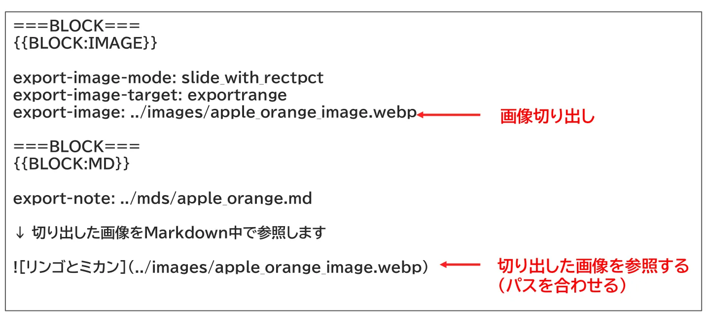

<!-- md_merge_rawtitle: MDテキスト中での画像参照 -->
{{#id:section:pdf1_minimum:slide8}}
## MDテキスト中での画像参照

切り出した画像をMDテキスト中で参照するには、通常の Markdown 記法を使います。

{{vspace:1}}

{ width=100% }

{{vspace:1}}

画像ファイルのパスが合っていれば参照可能です。