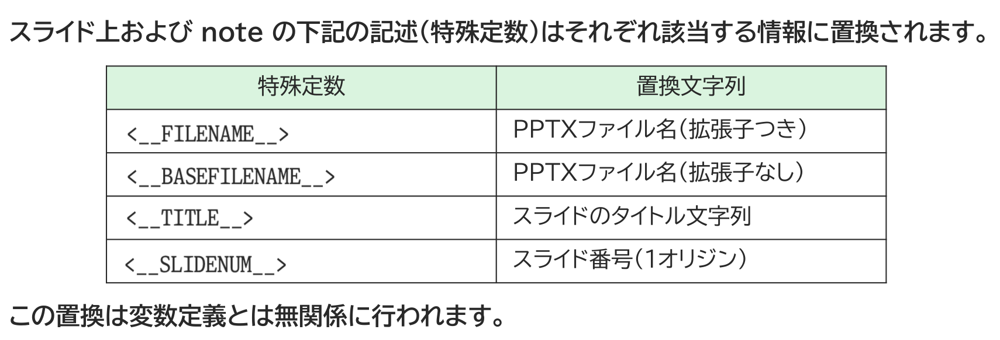

<!-- source: extracted/title_filename_guide_slide1_md.md -->
<!-- md_merge_rawtitle: TITLE、FILENAME置換 -->
<!-- #id:section:title_filename_guide:slide1 -->
## TITLE、FILENAME置換

結合pptx上でソースpptxを特定したい場合があります。その場合はソースpptxのファイル名やスライド番号、スライドタイトルに置換される特殊定数を使うことにより可能です。

スライド上および note の下記の記述（特殊定数）はそれぞれ該当する情報に置換されます。

この置換は変数定義とは無関係です。同一のテキスト文言を異なる意図で使わないようにご注意ください（強制置換されます）。

