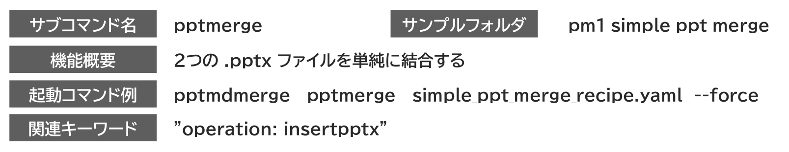
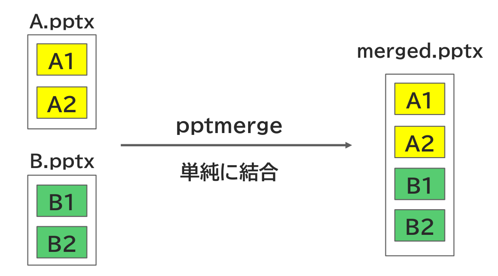
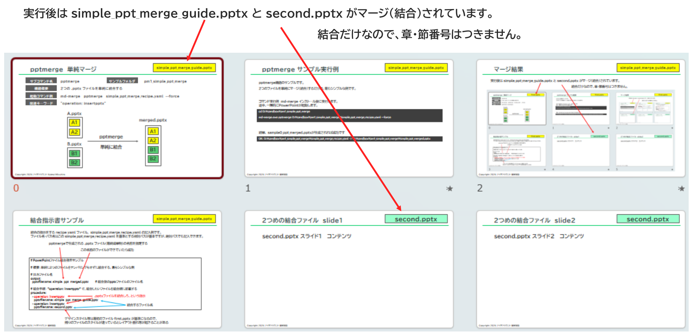
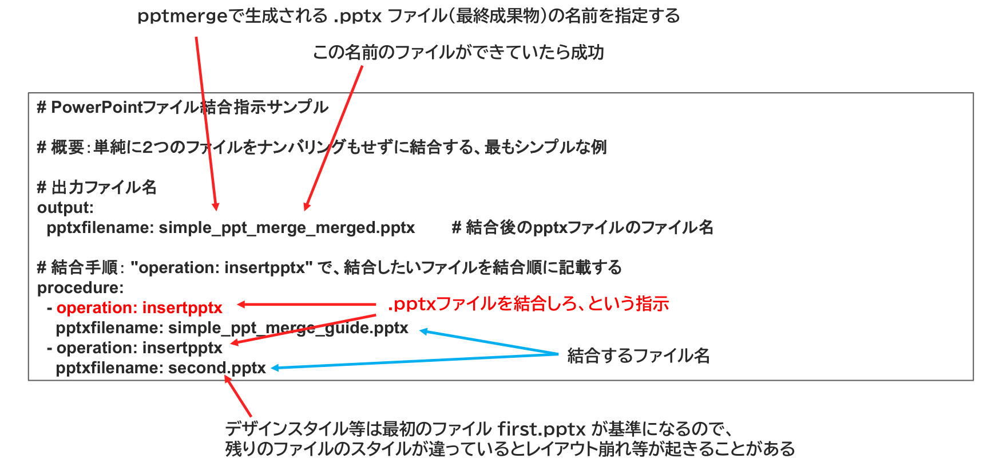

<!-- source: ../mds/simple_ppt_merge_guide_slide1_md.md -->
<!-- md_merge_rawtitle: pptmerge 単純マージ -->
<!-- #id:section:simple_ppt_merge_guide:slide1 -->
## pptmerge　単純マージ

単純マージは２つのpptxファイルを単に結合するだけの、最も単純な機能です。

結合指示書には関連キーワード欄の命令を使って結合対象ファイルを記載します。これについては後述します。

処理のイメージは下記の通りです。






<!-- source: ../mds/simple_ppt_merge_guide_slide2_md.md -->
<!-- md_merge_rawtitle: pm1_simple_ppt_merge 概要 -->
<!-- #id:section:simple_ppt_merge_guide:slide2 -->
## pm1_simple_ppt_merge 概要

simple_ppt_merge_guide.pptx は、２つのpptxファイルを単に結合するだけの単純マージを行うサンプルです。

データフォルダ:  PROJECT_ROOT\\examples\\pm1_simple_ppt_merge

### サンプルファイル一覧

| 番号 | ファイル名         |          内容                |
| --- | --------------- | ------------------------ |
| 1 | src/simple_ppt_merge_guide_recipe.yaml | 結合指示書：マージ処理の仕様を示す  |
| 2 | src/simple_ppt_merge_guide.pptx  |  このサンプルの説明書ソースpptx  |
| 3 | src/second.pptx                  | 結合元ファイルサンプル（3スライド）   |
| 4 | build/simple_ppt_merge_merged.pptx       | 2と3の結合結果   |

ファイル2 + ファイル3 → ファイル4 という結合処理を行います。

### 実行命令

ファイル1の結合指示書に結合対象ファイルを記載します（後述します）。

以下の命令で実行します。サブコマンド pptmerge の引数に結合指示書を指定します。途中、一時的に PowerPoint が起動します。 --force は既出力ファイルを上書きするオプションです。

```bash
pptmdmerge pptmerge PROJECT_ROOT\examples\pm1_simple_ppt_merge\src\simple_ppt_merge_guide_recipe.yaml --force
```

結果、ファイル4が生成されれば成功です


<!-- source: ../mds/simple_ppt_merge_guide_slide3_md.md -->
<!-- md_merge_rawtitle: マージ結果 -->
<!-- #id:section:simple_ppt_merge_guide:slide3 -->
## マージ結果

実行後は2つのpptxファイルがマージ（結合）されています。

結合だけなので、章・節番号はつきません。




<!-- source: ../mds/simple_ppt_merge_guide_slide4_md.md -->
<!-- md_merge_rawtitle: 結合指示書サンプル -->
<!-- #id:section:simple_ppt_merge_guide:slide4 -->
## 結合指示書サンプル

結合指示書では、output.pptxfilename: に結合後のpptxファイル名を記載し、
procedureセクションに　operation: insertpptx の配列で結合対象ファイルを記載します。



PowerPointのデザインスタイル等は最初のファイル first.pptx が基準になるので、残りのファイルのスタイルが違っているとレイアウト崩れ等が起きることがあるのでご注意ください。