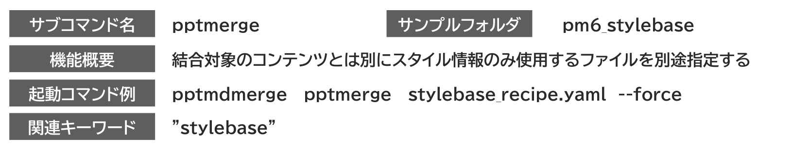
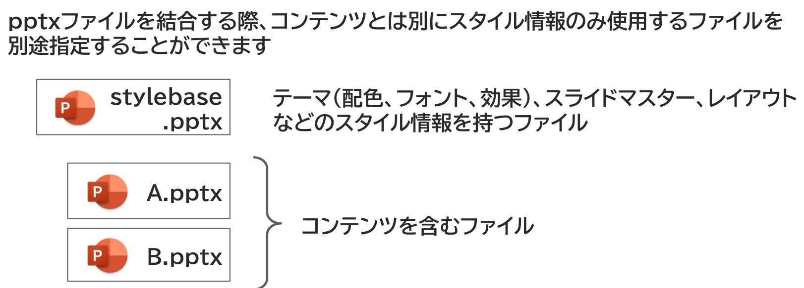
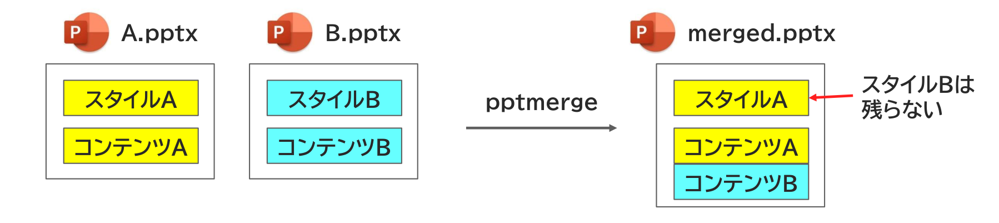
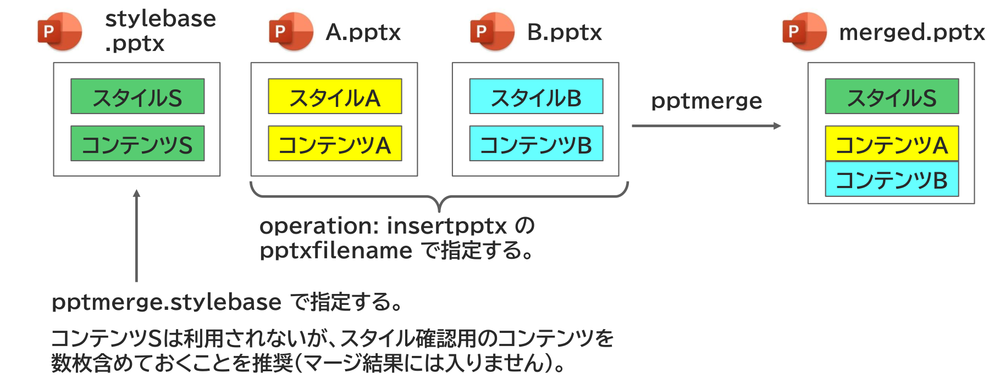
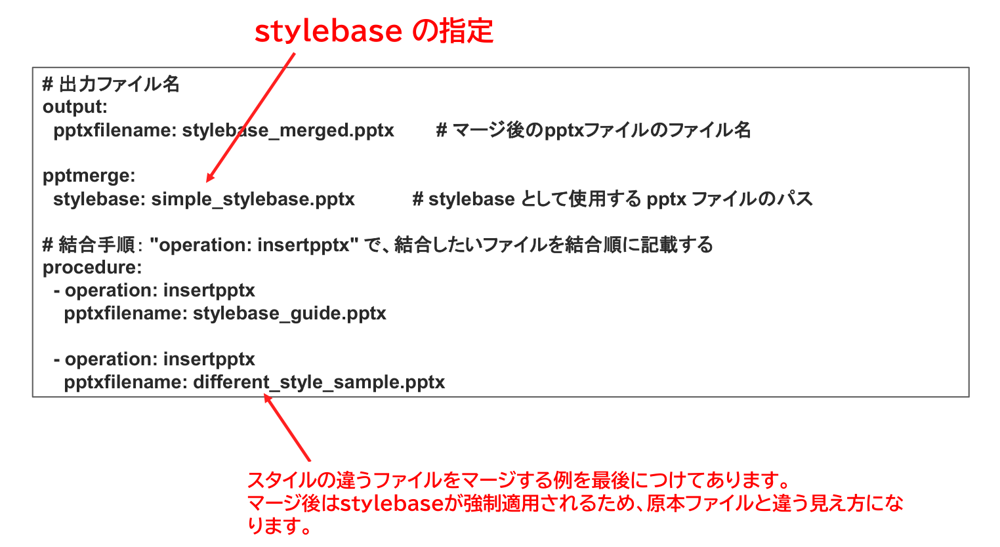
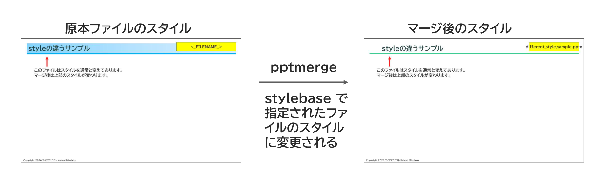

<!-- source: extracted/stylebase_guide_slide1_md.md -->
<!-- md_merge_rawtitle: stylebaseを別に指定する機能 -->
<!-- #id:section:stylebase_guide:slide1 -->
## stylebaseを別に指定する機能

pptxをマージする際、基準とするスタイルをコンテンツとは別に指定することができます。

<!-- source: extracted/stylebase_guide_slide2_md.md -->
<!-- md_merge_rawtitle: なぜstylebaseを別途指定すべき？ -->
<!-- #id:section:stylebase_guide:slide2 -->
## なぜstylebaseを別途指定すべき？

一般に、pptxファイルにはスタイル情報とコンテンツが含まれており、複数のファイルの
マージ処理(pptmerge)では　「コンテンツ」 を結合します。

スタイル情報は最初のファイルのものだけが使われます。

しかし、コンテンツファイルは一般に頻繁に更新されるものです。

コンテンツとスタイルを混在させていると　 **「うっかり、スタイルまで更新してしまう」** 　事態が起きます。　

スタイルが合わないとレイアウト崩れ、配色崩れなどが起きるため、スタイル情報はコンテンツとは別に管理することが望ましいのです。

<!-- source: extracted/stylebase_guide_slide3_md.md -->
<!-- md_merge_rawtitle: stylebaseを別途指定するしくみ -->
<!-- #id:section:stylebase_guide:slide3 -->
## stylebaseを別途指定するしくみ

そこで、スタイル情報を別のファイルに分離することを推奨します。　

スタイル情報は一般に、複数の文書、複数のプロジェクトで共通に使われるものなので、共通資材フォルダに置くとよいでしょう。

<!-- source: extracted/stylebase_guide_slide4_md.md -->
<!-- md_merge_rawtitle: 結合指示書サンプル -->
<!-- #id:section:stylebase_guide:slide4 -->
## 結合指示書サンプル

サンプルファイルとして、マージによってスタイルが変わる例を格納してあります。

different_style_sample.pptx は simple_stylebase.pptx とは違うスタイルで作られていますが、マージ後の stylebase_merged.pptx を見ると simple_stylebase.pptx のスタイルに変更されています。

<!-- source: extracted/different_style_sample_slide1_md.md -->
<!-- md_merge_rawtitle: styleの違うサンプル -->
<!-- #id:section:different_style_sample:slide1 -->
## styleの違うサンプル

左側が different_style_sample.pptx のスタイルです。　それがマージ後の stylebase_merged.pptx 末尾では右側のスタイルに変更されていることを確認してください。

