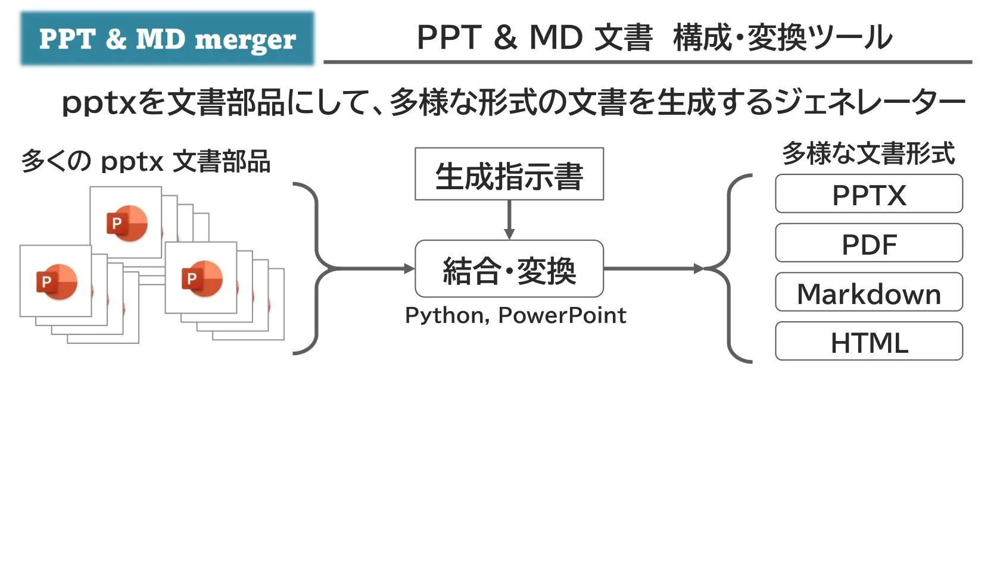

<!-- md_merge_rawtitle: PPT & MD merger とは？ -->
{{#id:section:readme_file:slide1}}
## PPT \& MD merger とは？

PPT \& MD merger は、「pptxファイルを文書部品として扱い、多様な形式の文書を生成できるジェネレーター」 です。　（ツールそのものは Python スクリプトであり、Windows + PowerPoint 環境で動作します）

::: {.center}

{ width=95% }

:::