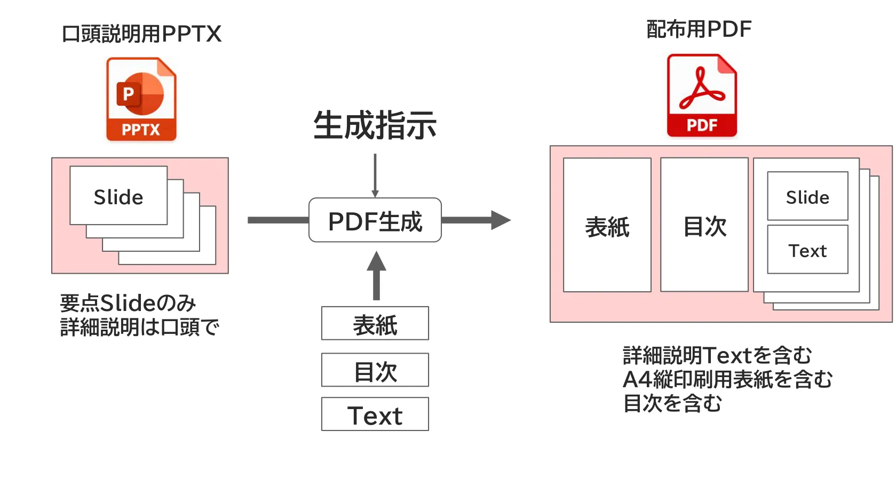

<!-- md_merge_rawtitle: 複数のPPTXをまとめて１つのPDFを生成する用途 -->
{{#id:section:readme_file:slide2}}
## 複数のPPTXをまとめて１つのPDFを生成する用途

PPT \& MD merger の主な用途の１つが、複数の PowerPoint ファイル *.PPTX （基本的にはプロジェクター投影＋口頭説明という形で使用するもの）をソースにして、配布用PDFファイル（印刷して、またはデータで配付して「読むだけで理解してもらうことを期待する」もの）を作成することです。　

::: {.center}

{ width=95% }

:::

さらに、このときに生じる

::: {.blockindent indent=2em}
- 複数のPPTXをまとめて１つの配布用PDFにしたい
- 口頭で説明していた内容を詳細説明Textとして追加したい
- プレーンテキストでは物足りない。文字サイズ、フォント、配色などを変えてメリハリをつけられるようにしたい
- A4縦に印刷したときに読みやすいレイアウトにしたい
- 表紙をつけたい
- 章/節番号をつけたい
- 目次をつけたい
:::

などの課題を一括して解決するのが PPT \& MD merger です。

この用途の実際の使用例と使い方解説はこちらから → [PPTXをもとにPDFを生成するサンプル](/examples/pdf1_minimum/README.md)