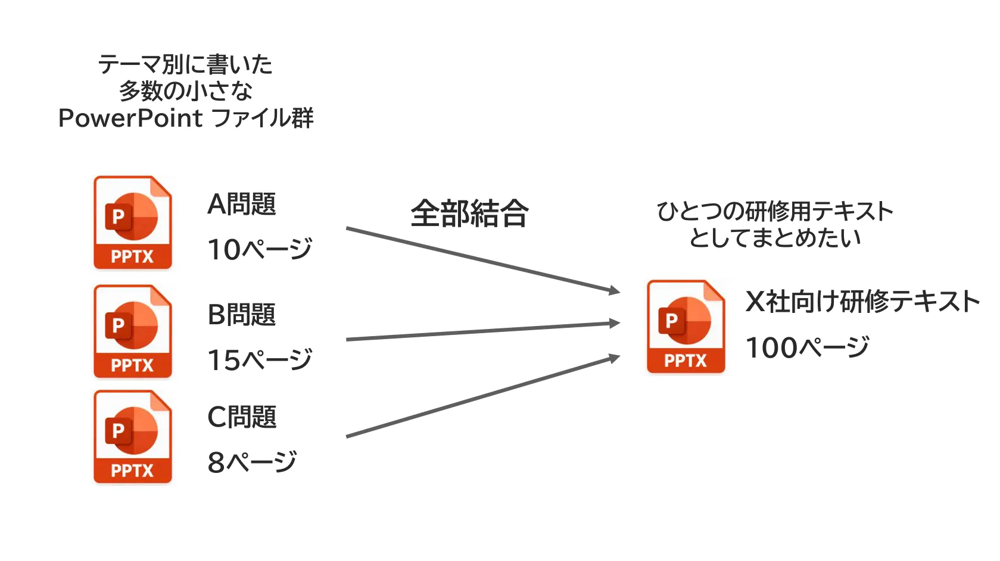

<!-- md_merge_rawtitle: 複数のPPTXをまとめて１つのPPTXを生成する用途 -->
{{#id:section:readme_file:slide3}}
## 複数のPPTXをまとめて１つのPPTXを生成する用途

PPT \& MD merger の主な用途の２つめは、複数の PowerPoint ファイル *.PPTX をソースにして、１つの大きな PPTX ファイルを作成することです。

::: {.center}

{ width=95% }

:::

典型的なのが研修用テキストを作る場面で、企業研修を行う場合は複数の小テーマ *.PPTX をまとめて１冊にしたい場合があります。

しかも、研修を何度も行うと、その都度少しずつ内容が変わっていくのが普通で、一度作った大きな１冊を何度も流用するのは難しいものです。　その都度小テーマ PPTXを更新して組み替えて結合して、という作業をしなければなりませんが、この労力は馬鹿になりません。　というのは、たいてい「単なる結合」では済まないからです。

::: {.blockindent indent=2em}
- 複数のPPTXをまとめたい
- 表紙をつけたい
- 章/節番号をつけたい
- 目次をつけたい
- 講師用ファイルと配布用ファイルを別に作りたい
- 固有名詞等（会社名など）を一括差し替えしたい
:::

など、細かな課題がいろいろと出てきます。これらを一括して解決するのが PPT \& MD merger です。

この用途の実際の使用例と使い方解説はこちらから → [複数のPPTXをまとめて１つのPPTXを生成するサンプル](/examples/overview/README.md)